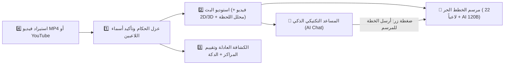

# ⚽ الدليل الشامل والمفصّل لمشروع EGY-SCOUT V8
### (شرح مرئي كامل بالصفحة والزرار والأداة — للمبتدئ والمدرب ومحلل الأداء والمطور)

> **آخر تحديث:** الإصدار `V8.2 Pro Studio` — يشمل: التحليل الثنائي للفريقين (22 لاعباً)، حرية التعديل الكامل على ناديك والخصم، مرسم الخطط الحر + ابتكار الخطط المجنونة بالذكاء الاصطناعي متعدد الموديلات (`GPT-OSS 120B` / `Qwen 3.8 27B` / `GPT-OSS 20B` / `ALLaM 2 7B`)، استيراد فيديوهات `MP4` ويوتيوب `YouTube`، وتصدير الخطط كصور `PNG`.

---

## 📑 فهرس المحتويات (اضغط للانتقال فوراً)
1. [ما هو EGY-SCOUT V8؟ (ببساطة للمبتدئ)](#-1-ما-هو-egy-scout-v8-ببساطة-للمبتدئ)
2. [الشكل العام للتطبيق وخريطة الشاشة الرئيسية](#-2-الشكل-العام-للتطبيق-وخريطة-الشاشة-الرئيسية)
3. [تفصيل الشريط العلوي والقائمة الجانبية (زر بزر)](#-3-تفصيل-الشريط-العلوي-والقائمة-الجانبية-زر-بزر)
4. [الصفحة الأولى: عزل الحكام وتأكيد الهوية (Accuracy & QA)](#-4-الصفحة-الأولى-عزل-الحكام-وتأكيد-الهوية-accuracy--qa)
5. [الصفحة الثانية: استوديو البث والـ 3D ومرسم الخطط (Broadcast Studio)](#-5-الصفحة-الثانية-استوديو-البث-والـ-3d-ومرسم-الخطط-broadcast-studio)
   - [5.1 مشغّل الفيديو وأدوات الرسم التكتيكي (Video Telestrator)](#51-مشغّل-الفيديو-وأدوات-الرسم-التكتيكي-video-telestrator)
   - [5.2 التوأم التكتيكي التفاعلي (2D / 3D WebGL / Player-POV)](#52-التوأم-التكتيكي-التفاعلي-2d--3d-webgl--player-pov)
   - [5.3 معمل ابتكار الكرات الثابتة (Set-Piece Lab)](#53-معمل-ابتكار-الكرات-الثابتة-set-piece-lab)
   - [5.4 محلل حالة اللحظة للفريقين (عمل إيه / معملش إيه / فين وليه)](#54-محلل-حالة-اللحظة-للفريقين-عمل-إيه--معملش-إيه--فين-وليه)
   - [5.5 مرسم الخطط التكتيكي الحر والـ AI (تحكم 100% في الـ 22 لاعباً)](#55-مرسم-الخطط-التكتيكي-الحر-والـ-ai-تحكم-100-في-الـ-22-لاعباً)
6. [الصفحة الثالثة: الكشافة العادلة وتقييم المراكز وإعداد المباراة (Fair Scouting)](#-6-الصفحة-الثالثة-الكشافة-العادلة-وتقييم-المراكز-وإعداد-المباراة-fair-scouting)
7. [الصفحة الرابعة: استيراد وتحليل مقاطع الفيديو ويوتيوب (Quick Analysis)](#-7-الصفحة-الرابعة-استيراد-وتحليل-مقاطع-الفيديو-ويوتيوب-quick-analysis)
8. [المساعد التكتيكي الذكي العائم (AI Tactical Chatbot)](#-8-المساعد-التكتيكي-الذكي-العائم-ai-tactical-chatbot)
9. [4 وصفات عملية سريعة للمبتدئ (نفّذها في 60 ثانية)](#-9-4-وصفات-عملية-سريعة-للمبتدئ-نفّذها-في-60-ثانية)
10. [دليل التشغيل التقني، هيكل الملفات، وحل المشاكل الشائعة](#-10-دليل-التشغيل-التقني-هيكل-الملفات-وحل-المشاكل-الشائعة)

---

## 🎯 1. ما هو EGY-SCOUT V8؟ (ببساطة للمبتدئ)

**EGY-SCOUT V8** هو **استوديو تحليل كروي وذكي متكامل** يحوّل أي فيديو لمباراة كرة قدم (سواء من جهازك `MP4` أو من رابط يوتيوب `YouTube`) إلى:
1. **رؤية حاسوبية حقيقية (Computer Vision — 4-Class Football YOLO):** تكتشف **الفريق الأول (ناديك)** و**الفريق الثاني (الخصم)** و**حراس المرمى** و**الكرة** وتعزل **الحكام** بنسبة تسرب شبه معدومة (`0%`) بدون الخلط مع لون العشب الأخضر.
2. **استوديو بث تكتيكي (Broadcast Studio):** ترسم فيه على الفيديو الحقيقي (إضاءة لاعب، أسهم، قياس مسافات بالمتر، ربط خط دفاع، وتحريك أي لاعب من **ناديك أو الخصم** كـ "شبح What-If" لتعرف كيف يتغير خطر التسديد `xG` فوراً).
3. **ملعب 2D و 3D ثلاثي الأبعاد وكاميرا عين اللاعب (`Player-POV`):** تعرض تحركات الـ 22 لاعباً والكرة بالارتفاع الفعلي.
4. **مرسم خطط تكتيكي حر 100% + ذكاء اصطناعي مبتكر:** تتحكم فيه بكل صغيرة وكبيرة في **ناديك والخصم معاً** (تحريك اللاعبين، توجيه رؤوس الأسهم، تعديل أسماء وأرقام وأدوار وواجبات كل لاعب، إضافة أو حذف لاعبين، رسم أسهم ومناطق بألوانك، حفظ خططك، وتحميلها كصورة `PNG`) — أو تطلب من الذكاء الاصطناعي (`GPT-OSS 120B` / `Qwen 3.8 27B`) ابتكار **أي خطة مجنونة لم تُلعب من قبل** فيرسم لك الـ 22 إحداثياً مباشرة!
5. **محلل تكتيكي ذكي (AI Chatbot):** تسأله أي سؤال عن المباراة واللاعبين والسرعات والأخطاء أو تطلب منه رسم خطة فيرسمها داخل الشات ويرسلها للملعب الكبير بضغطة زر.

---

## 🖥️ 2. الشكل العام للتطبيق وخريطة الشاشة الرئيسية

التطبيق مصمّم بواجهة داكنة احترافية (`Dark Tactical Broadcast Theme` — خلفية `#090D16` وأخضر زمردي `#10B981`)، ويدعم اللغة **العربية (يمين لليسار RTL)** والإنجليزية **(LTR)** بالكامل.

### خريطة تخطيط الشاشة (Visual Wireframe)

```text
┌───────────────────┬───────────────────────────────────────────────────────────────────────┐
│   القائمة الجانبية  │  الشريط العلوي (Top Header Bar)                                        │
│   (Sidebar RTL)   │  [● المباريات المتاحة]  [الأهلي×إنبي] [مباراة 2] ... [+ رفع مباراة]    │
│                   │  [🤖 المساعد الذكي]  [📄 تقرير النادي]  [👤 الدور ▼]  [EN / عربي]     │
│  ⚽ EGY-SCOUT V8  ├───────────────────────────────────────────────────────────────────────┤
│                   │                                                                       │
│  [1] 🛡️ عزل الحكام │                                                                       │
│      وتأكيد الهوية │                     مساحة المحتوى الرئيسية                             │
│                   │               (تتغير حسب الصفحة المختارة من اليمين)                    │
│  [2] 📺 استوديو    │                                                                       │
│      البث والـ 3D │   • الصفحة 1: مقارن قبل/بعد + ورقة التأكيد السريع للهويات              │
│                   │   • الصفحة 2: الفيديو + الـ 2D/3D + محلل اللحظة + مرسم الـ 22 لاعباً   │
│  [3] 🎯 الكشافة   │   • الصفحة 3: رادار الكشافة + إعداد المباراة + الدكة والتبديلات        │
│      العادلة      │   • الصفحة 4: رفع MP4 أو رابط يوتيوب + نتائج التتبع                    │
│                   │                                                                       │
│  [4] ⚡ تحليل مقطع │                                                                       │
│      (فيديو/يوتيوب)│                                              ┌──────────────────────┐ │
│                   │                                              │ 🤖 المساعد التكتيكي  │ │
│  ✅ بيانات موثّقة  │                                              │    الذكي (زر عائم)   │ │
└───────────────────┴──────────────────────────────────────────────┴──────────────────────┘ │
```

### مخطط تدفق العمل بين الصفحات (Mermaid Flow)



---

## 🧭 3. تفصيل الشريط العلوي والقائمة الجانبية (زر بزر)

### أ) القائمة الجانبية الثابتة (`Sidebar` — على يمين الشاشة في العربي)

| الزر / العنصر | الأيقونة | ماذا يفعل بالضبط؟ | متى تستخدمه؟ |
| :--- | :---: | :--- | :--- |
| **عزل الحكام وتأكيد الهوية** | 🛡️ | يفتح **الصفحة 1** لمقارنة دقة التتبع قبل/بعد وتسمية اللاعبين الحقيقيين بالصور المقصوصة. | أول خطوة بعد فتح مباراة للتأكد من دقة الأسماء وعزل الحكام. |
| **استوديو البث والـ 3D** | 📺 | يفتح **الصفحة 2** (القلب التكتيكي): الفيديو + الرسم + 2D/3D/POV + تحليل اللحظة + مرسم الخطط الـ 22 لاعباً. | الصفحة الافتراضية الرئيسية للتحليل ورسم الخطط. |
| **الكشافة العادلة** | 🎯 | يفتح **الصفحة 3**: تقييم اللاعبين الموزون حسب المركز، استيراد CSV، قائمة المختصرين، وإعدادات الدكة والملعب. | عند تقييم لاعب أو محاكاة تبديل أو طرد أو تغيير مقاس الملعب. |
| **تحليل مقطع سريع** | ⚡ | يفتح **الصفحة 4**: رفع ملف `MP4` أو لصق رابط `YouTube` لمعالجته بالذكاء الاصطناعي وإضافته للمباريات. | عندما تريد تحليل مباراة جديدة غير موجودة في القائمة. |
| **شارة "بيانات موثّقة • صفر تخمين"** | 🟢 | مؤشر حالة أسفل القائمة يؤكد أن كل الأرقام والإحداثيات مرتبطة بملف التتبع الحقيقي (`tracks.parquet`). | للتأكد أن النظام يعمل ببيانات حقيقية لا وهمية. |

### ب) الشريط العلوي (`Top Header` + `Multi-Match Switcher Bar`)

| الزر / العنصر | مكانه في الشريط | ماذا يفعل بالضبط؟ | مثال عملي للمبتدئ |
| :--- | :--- | :--- | :--- |
| **أزرار اختيار المباراة** (مثلاً: `الأهلي × إنبي`، `بيراميدز × المصري`، `الأهلي × طلائع الجيش`...) | الصف السفلي من الشريط العلوي | يبدّل المباراة النشطة في **كامل التطبيق فوراً** (الفيديو، الصور، اللاعبون، الإحصائيات، والشات). | اضغط على `بيراميدز × المصري` لتنتقل كل الشاشات لتحليل هذه المباراة فوراً. |
| **زر `+ رفع / تحليل مباراة جديدة`** | آخر شريط المباريات (أخضر) | ينقلك مباشرة إلى **الصفحة 4** لاستيراد فيديو جديد من جهازك أو من يوتيوب. | عندك لقطة لمباراة جديدة؟ اضغط هذا الزر وارفعها. |
| **زر `🤖 المساعد التكتيكي الذكي (AI Chat)`** | الصف العلوي — وسط/يسار (أخضر بارز) | يفتح أو يغلق نافذة الشات التكتيكي الذكي المتصل ببيانات المباراة الحالية. | اضغط عليه واسأله: *"من أخطأ في هذه اللقطة؟"* أو *"ارسم لي خطة 3-5-2"*. |
| **زر `تقرير النادي` (`Club Report`)** | الصف العلوي بجانب الشات | يفتح ملف تقرير احترافي (`White-Label HTML Dossier`) جاهز للطباعة أو الحفظ كـ **PDF** فيه ملخص المباراة والكشافة وأهم اللقطات. | اضغط عليه ثم `Ctrl + P` لتحفظ ملف PDF وتقدمه لرئيس النادي أو المدرب. |
| **قائمة اختيار الصلاحية / الدور (`Role Selector`)** | الصف العلوي (`محلل أداء ▼`) | يغيّر صلاحياتك داخل التطبيق بين 5 أدوار: `محلل أداء` (كامل الصلاحيات)، `المدير الفني`، `كشاف`، `مجلس الإدارة (عرض فقط)`، `حساب اللاعب (عرض فقط)`. | اختبر وضع `مجلس الإدارة` لترى كيف يتم قفل أزرار التعديل تلقائياً لحماية البيانات. |
| **زر `EN / عربي`** | أقصى يسار الشريط العلوي | يبدّل لغة كل القوائم والأزرار والاتجاه (`RTL ↔ LTR`) فوراً بدون إعادة تحميل الصفحة. | اضغط `EN` إذا كان لديك مدرب أجنبي يعمل معك على نفس الجهاز. |

---

## 🛡️ 4. الصفحة الأولى: عزل الحكام وتأكيد الهوية (`Accuracy & QA`)

### الشكل البصري للصفحة

```text
┌──────────────────────────────────────────────────────────────────────────────┐
│  عنوان الصفحة: عزل الحكام وتأكيد الهوية              [الفريم: #1250 • حالة الحكم ▼] │
├──────────────────────────────────────────────────────────────────────────────┤
│  ┌──────────────────────────────┃──────────────────────────────┐             │
│  │  يسار (قبل): تجميع ثنائي     ┃   يمين (بعد): عزل ذكي 4 فئات  │             │
│  │  ❌ تسرب الحكم داخل فريق    ┃   ✅ عزل الحكم + تثبيت الفريق │             │
│  └──────────────────────────────┃──────────────────────────────┘             │
│  [مؤشرات الأداء: دقة الفريقين | تسرب الحكام | ثبات المسار | سقف الحراس]         │
├──────────────────────────────────────────────────────────────────────────────┤
│  ورقة التأكيد السريع للهويات (2-Minute QA)                                     │
│  [⚡ توزيع تلقائي لقائمة المباراة]   [💾 حفظ التأكيدات وتحديث الفيديو]           │
│  [مرئي بالفريم (14)]  [أهم مسارات المباراة (23)]   [📋 قائمة المباراة الرسمية ▼] │
│                                                                              │
│  ┌─────────────────────────┐  ┌─────────────────────────┐                    │
│  │ [صورة اللاعب الحقيقية]   │  │ [صورة اللاعب الحقيقية]   │                    │
│  │ مسار #7  🟢 مرئي بالفريم │  │ مسار #12 🟢 مرئي بالفريم │                    │
│  │ الدور: [لاعب ميدان ▼]   │  │ الدور: [حارس مرمى ▼]    │                    │
│  │ الفريق: [الأهلي ▼]      │  │ الفريق: [الأهلي ▼]      │                    │
│  │ التشكيل: [اختر لاعب ▼]  │  │ التشكيل: [اختر لاعب ▼]  │                    │
│  │ الرقم:[10] الاسم:[بيرسي]│  │ الرقم:[1] الاسم:[الشناوي]│                    │
│  │      [ ✓ تأكيد الهوية ]  │  │     [ هوية مؤكدة ✓ ]    │                    │
│  └─────────────────────────┘  └─────────────────────────┘                    │
└──────────────────────────────────────────────────────────────────────────────┘
```

### جدول تفصيلي لكل زر وحقل في الصفحة الأولى

| العنصر / الزر | مكانه | ماذا يفعل بالضبط؟ | مثال عملي |
| :--- | :--- | :--- | :--- |
| **قائمة اختيار الفريم (`الفريم ▼`)** | أعلى يسار البطاقة الأولى | تختار اللقطة (الفريم) التي تريد فحصها ومقارنة قبل/بعد عليها (الافتراضي `#1250` حيث يظهر الحكم). | اختر فريم آخر لترى اللاعبين الظاهرين في تلك اللحظة بالذات. |
| **المنزلق التفاعلي (`Before / After Slider`)** | فوق صورة المباراة الكبيرة | اسحبه بالماوس يميناً ويساراً للمقارنة الحية بين التتبع القديم (الذي يخلط الحكم باللاعبين) والتتبع المطور (`4-Class Shield`). | اسحبه لليسار لترى الحكم باللون الأصفر معزولاً تماماً عن الفريقين. |
| **بطاقات الدقة الـ 4 (KPIs)** | أسفل صورة المقارنة | تعرض أرقاماً حقيقية من `tracks.parquet`: دقة فصل الفريقين، نسبة تسرب الحكام (`0%`)، ثبات هوية المسار، والحد الأقصى لحراس المرمى (`≤ 2`). | تعطيك ضماناً فورياً قبل أن تبدأ في إخراج أرقام التقييم. |
| **زر `⚡ توزيع تلقائي لقائمة المباراة`** | رأس ورقة الهويات (أصفر/زمردي) | يوزّع أسماء وأرقام لاعبي الفريقين الرسميين تلقائياً بضغطة واحدة على المسارات الحقيقية حسب مركزهم وحارس المرمى! | بدل ما تكتب 22 اسماً يدوياً، اضغطه مرة واحدة وسيمتلئ الجدول في ثانية. |
| **زر `حفظ التأكيدات وتحديث الفيديو`** | بجانب التوزيع التلقائي (أخضر) | يحفظ كل الأسماء والأرقام والأدوار التي أكدتها على السيرفر، ويحدّثها فوراً في استوديو البث والـ 2D والـ 3D والشات! | اضغطه دائماً بعد الانتهاء من تعديل أي اسم لاعب. |
| **زرا التصفية (`مرئي بالفريم` / `أهم مسارات المباراة`)** | تحت عنوان ورقة الهويات | الأول يعرض اللاعبين الظاهرين في اللقطة الحالية فقط؛ الثاني يعرض جميع لاعبي وحكام المباراة بالكامل. | استخدم `مرئي بالفريم` للتركيز السريع على اللاعبين الظاهرين أمامك الآن. |
| **زر `قائمة المباراة الرسمية` + مربع النص + `تحليل وتطبيق القائمة`** | صندوق قابل للفتح أعلى الكروت | تلصق فيه أي قائمة أسماء نصية (مثل `1 - محمد الشناوي`، `22 - إمام عاشور`) فيفهمها المحرك تلقائياً ويضعها داخل القائمة السريعة لكل كارت. | انسخ التشكيلة من موقع الكورة والصقها هنا ثم اضغط `تحليل وتطبيق القائمة`. |
| **صورة اللاعب المقصوصة داخل الكارت** | يمين كل كارت لاعب | صورة حقيقية مقصوصة من الفيديو لنفس اللاعب (`track_crop`)، وعند الضغط على الكارت يتم **تسليط دائرة ضوء صفراء** على هذا اللاعب مباشرة في الصورة الكبيرة بالأعلى! | اضغط على أي كارت لتعرف فوراً أين يقف هذا اللاعب في الملعب. |
| **قائمة الدور (`لاعب ميدان / حارس مرمى / حكم ساحة / حكم مساعد`)** | داخل كارت اللاعب | تغيّر تصنيف هذا المسار إذا أردت تحويل لاعب إلى حارس مرمى أو عزل حكم مساعد. | إذا التقطت الكاميرا حكم راية، حوّله إلى `حكم مساعد`. |
| **قائمة الفريق (`فريق أ / فريق ب / تحكيم`)** | داخل كارت اللاعب | تحدد لأي فريق ينتمي اللاعب (ناديك أم الخصم أم طاقم التحكيم). | تصحح بها أي لاعب في حال تشابهت ألوان القمصان في ظل الملعب. |
| **قائمة `⚡ اختر لاعب من التشكيل الرسمي`** | داخل كارت اللاعب | قائمة منسدلة تختار منها اسم اللاعب الرسمي فتملأ خانة **الرقم** و**الاسم** تلقائياً وتفعّل التوثيق! | اختر `22 • إمام عاشور` فيمتلئ الرقم `22` والاسم تلقائياً. |
| **خانتا `الرقم #` و `اسم اللاعب المؤكد`** | أسفل كارت اللاعب | كتابة يدوية حرة لأي رقم قميص أو اسم لاعب جديد. | اكتب اسم لاعب ناشئ جديد غير موجود في القائمة الرسمية. |
| **زر `تأكيد الهوية` / `هوية مؤكدة ✓`** | أسفل الكارت | يغيّر حالة الكارت إلى **مؤكد باللون الأخضر** ليدخل في التقرير النهائي الرسمي. | اضغطه بعد التأكد من صحة اسم ورقم اللاعب. |

---

## 📺 5. الصفحة الثانية: استوديو البث والـ 3D ومرسم الخطط (`Broadcast Studio`)

هذه هي **الصفحة الرئيسية الأقوى في البرنامج** وتتكون من **5 أقسام متكاملة** تحت بعضها بترتيب منطقي:

```text
┌────────────────────────────────────────────────────────┬─────────────────────────────┐
│  [5.1] مشغّل الفيديو التكتيكي + أدوات الرسم على البث    │  [5.2] التوأم التكتيكي       │
│  ┌──────────────────────────────────────────────────┐  │  [2D] [3D Twin] [Player-POV]│
│  │   فيديو المباراة الحقيقي + طبقة الرسم AR Overlay  │  │  ┌───────────────────────┐  │
│  │   (دوائر اللاعبين + أسهم + قياس + Ghost للفريقين) │  │  │ ملعب 2D/3D تفاعلي     │  │
│  └──────────────────────────────────────────────────┘  │  │ (اسحب أي لاعب من     │  │
│  [▶ تشغيل] [◀ فريم ▶] [0.5x] ───●──────── [HLS] [MP4] │  │  ناديك أو الخصم!)      │  │
│  الأدوات: [🔦 ضوء] [👻 شبح] [🔗 سلسلة] [↗️ سهم] [📏 متر]│  │  [تحسين تلقائي What-If]│  │
│  [🟦 منطقة] [🗑️ مسح] | [🎬 تصدير MP4] [📄 ملف الخصم]  │  │  [إزاحة اللاعب | xG]   │  │
│                                                        ├─────────────────────────────┤
│                                                        │  [5.3] معمل الكرات الثابتة  │
│                                                        │  [ركنية يمين ▼] [⚡ محاكاة] │
├────────────────────────────────────────────────────────┴─────────────────────────────┤
│  [5.4] محلل حالة اللحظة للفريقين معاً (✅ فعل | ❌ لم يفعل | 📍 أين ولماذا)          │
├──────────────────────────────────────────────────────────────────────────────────────┤
│  [5.5] مرسم الخطط التكتيكي الحر والـ AI (22 لاعباً — تحكم 100% بناديك والخصم)         │
│  • شريط الـ AI + اختيار الموديل (GPT-OSS 120B / Qwen 3.8 / GPT-OSS 20B / ALLaM 2)    │
│  • لوحة تشكيل وستايل ناديك (Team A)   |   لوحة تشكيل وستايل الخصم (Team B)           │
│  • شريط الرسم (تحريك + أسهم + مناطق + قلم + 6 ألوان + خط متصل/متقطع + حفظ + PNG)    │
│  ┌─────────────────────────────────────────────┬──────────────────────────────────┐  │
│  │  ملعب 22 لاعباً تفاعلي (اسحب اللاعب         │  ✏️ تعديل عنوان/فلسفة/خطوات الخطة │  │
│  │  واسحب النقطة الصفراء في رأس السهم!)        │  👤 محرر اللاعب (أي لاعب من الـ22)│  │
│  └─────────────────────────────────────────────┴──────────────────────────────────┘  │
└──────────────────────────────────────────────────────────────────────────────────────┘
```

### 5.1 مشغّل الفيديو وأدوات الرسم التكتيكي (`Video Telestrator`)

| الزر / الأداة | ماذا يفعل بالضبط؟ | مثال عملي للمبتدئ |
| :--- | :--- | :--- |
| **زر التشغيل / الإيقاف (`▶ / ⏸`)** | يشغّل أو يوقف فيديو المباراة مع تزامن فوري (60 إطار/ثانية) مع الملعب الـ 2D والـ 3D. | أوقف الفيديو عند لحظة هدف أو تمريرة خاطئة لتبدأ الرسم عليها. |
| **زرا الفريم (`◀` و `▶`)** | يقدّمان أو يؤخّران الفيديو خطوة دقيقة جداً (فريم واحد) لفحص لحظة خروج الكرة من قدم اللاعب. | استخدمهما لفحص التسلل أو لحظة التمرير. |
| **أزرار السرعة (`0.25x` / `0.5x` / `1x`)** | تتحكم في سرعة البث البطيء لتحليل الهجمات السريعة. | شغّل `0.5x` لمتابعة تحركات خط الوسط ببطء. |
| **شريط الزمن (`Timeline Scrubber`)** | اسحبه لأي ثانية في المباراة، وتظهر عليه علامات الأحداث المهمة (`Key Moments`) للقفز إليها فوراً. | اضغط على علامة الهجمة الخطيرة لتقفز إليها مباشرة. |
| **🔦 أداة تسليط الضوء (`Spotlight`)** | اضغط على **أي لاعب من ناديك أو الخصم** على الفيديو ليظهر حوله عمود إضاءة تلفزيوني (`Broadcast Cone`) واسمه وسرعته. | اضغط على المهاجم والمدافع المراقب له لتبرز الصراع بينهما في الفيديو. |
| **👻 أداة تحريك الشبح (`Ghost What-If` — للفريقين!)** | **مفعّلة الآن لكل من لاعبي ناديك (`team_a`) ولاعبي الخصم (`team_b`) والحراس!** اضغط على أي لاعب فوق الفيديو واسحبه لمكان جديد، فيرسم شبحه ويعيد حساب خطورة التسديد `xG` فوراً! | اسحب مدافع ناديك 3 أمتار للداخل لترى كيف تنخفض خطورة الخصم `xG` من `0.38` إلى `0.19`! |
| **🔗 أداة ربط السلسلة (`Chain`)** | اضغط على 3 أو 4 لاعبين على الفيديو لربطهم بخط تكتيكي متواصل يقيس تماسك خط الدفاع أو الوسط. | اربط رباعي خط ظهر فريقك لترى هل الخط على استقامة واحدة أم مكسور. |
| **↗️ أداة السهم (`Arrow`)** | اسحب بالماوس على الفيديو لرسم سهم توجيهي يشرح مسار تمريرة أو اختراق. | ارسم سهماً من صانع اللعب نحو الجناح الفارغ. |
| **📏 شريط القياس (`Tape`)** | اسحب بين أي لاعبين على الفيديو ليعرض لك المسافة الحقيقية بينهما **بالمتر** (مثلاً `14.2m`). | قِس المسافة بين قلبي الدفاع لتكشف الثغرة بالأرقام. |
| **🟦 أداة المنطقة (`Zone`)** | اسحب مستطيلاً على الفيديو لتظليل منطقة خطورة أو فراغ في الملعب. | ظلّل "المنطقة 14" أمام قوس منطقة الجزاء. |
| **🗑️ مسح الرسوم (`Clear`)** | يمسح كل الأسهم والمناطق والضوء المرسومة على الفيديو بضغطة واحدة. | استخدمه لتنظيف الشاشة قبل الانتقال للقطة التالية. |
| **🎬 تصدير لقطة `MP4` + خيار `طمس الوجوه`** | يقص المقطع المحدد ويحرق عليه رسوم التحليل (`AR Overlay`) وشعار النادي ويحمّله كفيديو `MP4` جاهز للواتساب أو غرفة الملابس! وإذا فعّلت `طمس الوجوه` يتم حماية خصوصية الناشئين. | حمّل لقطة مدتها 5 ثوانٍ وأرسلها للاعبين على جروب الفريق. |
| **📡 زر `بث HLS سريع`** | يحوّل الفيديو لبث سريع متقطع (`GOP-aligned HLS`) لتقديم وتأخير فوري بدون تقطيع حتى للمباريات الطويلة. | اضغطه إذا كنت تتصفح لقطة عالية الدقة وتريد سحباً فائق النعومة. |
| **📄 زر `ملف الخصم` (`Opponent Dossier`)** | يفتح بطاقة تلخص الأنماط الهجومية المرصودة وثغرات التحول الدفاعي للخصم بالأرقام والثواني. | راجعه قبل محاضرة ما قبل المباراة. |

### 5.2 التوأم التكتيكي التفاعلي (`2D / 3D WebGL / Player-POV`)

| الزر / العنصر | ماذا يفعل بالضبط؟ | مثال عملي للمبتدئ |
| :--- | :--- | :--- |
| **زرا `2D` / `3D Twin` / `Player-POV`** | • **`2D`**: ملعب مسطح تفاعلي ترى فيه الـ 22 لاعباً وخريطة السيطرة.<br>• **`3D Twin`**: ملعب **ثلاثي الأبعاد حقيقي (`Three.js WebGL`)** تقدر تسحبه بالماوس وتلف الكاميرا 360 درجة!<br>• **`Player-POV`**: كاميرا من داخل عيني اللاعب المحدد لتعرف ماذا كان يرى فعلياً في الملعب! | اضغط على لاعب وسطك ثم حوّل إلى `Player-POV` لترى هل كان يرى المهاجم الفارغ أم لا! |
| **أزرار الطبقات الأربعة (`📐 خطوط التشكيل`، `📡 قنوات التمرير`، `♟️ أسهم التصحيح`، `Zone 14`)** | تُظهر وتخفي فوق الملعب الـ 2D: خطوط ربط التشكيل الحية للفريقين، ممرات التمرير المفتوحة، أسهم التصحيح المقترحة من الذكاء الاصطناعي، ومربع المنطقة 14. | فعّلها كلها لترى تشريحاً هندسياً فورياً لكل ثانية في اللقطة. |
| **السحب المباشر على الملعب `2D` (لكلا الفريقين!)** | اضغط واسحب **أي لاعب من ناديك أو الخصم أو حارس المرمى** مباشرة على الملعب الـ 2D لتعديل تمركزه ومشاهدة تأثير الحركة على `xG` و `السيطرة الهجومية`. | اسحب الجناح الأيمن لناديك للعمق وشاهد كيف تتغير السيطرة الهجومية في الصندوق! |
| **زر `تحسين تلقائي (What-If)`** | يحسب لك المحرك الرياضي تلقائياً **أفضل خطوة تصحيحية** لتقليل خطورة الخصم وينفذها أمامك على الملعب. | اضغطه عندما تريد أن يريك البرنامج التمركز المثالي تلقائياً. |
| **زر `إعادة (0,0)`** | يرجّع اللاعب الذي حركته إلى مكانه الحقيقي الأصلي في الفيديو. | استخدمه للمقارنة بين الواقع والتعديل (`قبل ← بعد`). |
| **مربعا القياس (`إزاحة اللاعب` و `تغيّر خطورة التسديد xG`)** | يعرضان بالملّيمتر كم متراً حركت اللاعب (`ΔX, ΔY`) وكم تغيّرت خطورة الهدف (`xG`) بنسبة مئوية. | مثلاً: `0.34 → 0.18 (-47%)`. |

### 5.3 معمل ابتكار الكرات الثابتة (`Set-Piece Kinematic Sandbox`)
* **قائمة السيناريو:** تختار منها `ركنية يمين`، `ركنية يسار`، أو `ضربة حرة مباشرة`.
* **زر `تشغيل المحاكاة`:** يشغّل خوارزمية تحسين ذاتي (`Self-Play Rollouts`) ويُظهر حركة اللاعبين والكرة **بشكل متحرك حي** داخل الملعب الـ `2D` والـ `3D`!

### 5.4 محلل حالة اللحظة للفريقين (`Moment State Analyzer`)
* يقرأ تلقائياً اللحظة التي تقف عليها في الفيديو ويشرح لك **موقف الفريقين معاً (فريقك + الخصم)** بنظام بطاقات واضح جداً:
  * **✅ فعل (Did):** ما الذي نفّذه اللاعب فعلياً في هذه الثانية (مثلاً: ضغط بسرعة `24.5 كم/س` أو فتح زاوية تمرير).
  * **❌ لم يفعل (Did Not):** ما الذي فاته أو أهمله تكتيكياً (مثلاً: ترك ظهره مكشوفاً في المنطقة 14).
  * **📍 أين ولماذا (Where & Why):** مكانه الدقيق بالأمتار ولماذا تسبب هذا التمركز في خطورة أو فرصة.

### 5.5 مرسم الخطط التكتيكي الحر والـ AI (تحكم 100% في الـ 22 لاعباً)

هذا هو **أقوى مرسم خطط تكتيكي حر** — يعطيك حرية كاملة في تصميم وتعديل خطط **ناديك (`team_a`)** و**الخصم (`team_b`)** معاً، سواء يدوياً أو بالذكاء الاصطناعي متعدد الموديلات!

| القسم / الزر | مكانه داخل المرسم | ماذا يفعل بالضبط؟ | مثال عملي |
| :--- | :--- | :--- | :--- |
| **أزرار العرض (`الفريقان معاً 11 ضد 11` / `فريقك فقط` / `الخصم فقط`)** | أعلى يسار المرسم | تتحكم هل ترى الـ 22 لاعباً معاً أم تركز على ناديك فقط أم الخصم فقط. | اختر `فريقك فقط` أثناء رسم تمرينات البناء، ثم أعده لـ `الفريقان معاً` لتختبر الخطة ضد الخصم. |
| **قائمة اختيار موديل الذكاء الاصطناعي (`AI Model Picker`)** | داخل شريط الـ AI الأخضر | تختار منها بين **4 موديلات قوية** متاحة على مفتاح Groq السري:<br>1. **`GPT-OSS 120B`**: الأقوى لابتكار الخطط المجنونة والتحليل العميق.<br>2. **`Qwen 3.8 27B`**: ذكي جداً وسريع بالعربية وبناء الـ JSON.<br>3. **`GPT-OSS 20B`**: فائق السرعة للاستجابة اللحظية.<br>4. **`ALLaM 2 7B`**: نموذج عربي أصيل. | اختر `GPT-OSS 120B` للخطط المبتكرة المعقدة، أو `Qwen 3.8 27B` للسرعة الفائقة. |
| **مربع وصف الخطة للـ AI + زر `🎨 ارسم الخطة الآن`** | شريط الـ AI الأخضر | تكتب فيه **أي خطة عادية أو مجنونة لم تُلعب من قبل**! الذكاء الاصطناعي يحسب إحداثيات `(X, Y)` مخصصة لكل لاعب من الـ 22 لاعباً بحرية مطلقة (وليس مجرد قوالب محفوظة) ويرسم الأسهم والمناطق فوراً! | اكتب: *"ابتكر خطة مجنونة 2-1-6-1 بحارس ليبرو في منتصف الملعب وهجوم كاسح على الجبهة اليسرى"* واضغط `🎨 ارسم الخطة الآن`! |
| **أزرار الأمثلة الفورية (`✨ ابتكر خطة مجنونة...`)** | أسفل شريط الـ AI | 4 أفكار جاهزة (تشمل خططاً مجنونة وغير متماثلة + تيكي تاكا + ضغط عالي) ترسمها بضغطة زر واحدة. | جرّب الضغط على أول زر لترى حارس المرمى متقدماً كليبرو عند خط الوسط! |
| **لوحتا التشكيل والستايل (لوحة لناديك + لوحة للخصم)** | أسفل شريط الـ AI (يمين ويسار) | لكل فريق بشكل مستقل:<br>• **8 تشكيلات جاهزة** (`4-2-3-1`, `4-3-3`, `3-5-2`, `3-4-2-1`, `4-4-2`, `5-3-2`, `4-1-4-1`, `4-2-2-2`).<br>• **خانة تشكيل مخصص + زر `تطبيق`**: اكتب فيها أي أرقام مثل `3-2-4-1` أو `2-3-5` أو `1-4-5`!<br>• **قائمة الستايل (7 أساليب)**: متوازن، تيكي تاكا، ضغط عكسي، هجوم مرتد، أظهرة عكسية، اختراق أطراف، تكتل دفاعي. | ضع ناديك على `3-2-4-1` بستايل `تيكي تاكا`، وضع الخصم على `5-3-2` بستايل `تكتل دفاعي`! |
| **✋ أداة `تحريك اللاعبين ورأس السهم`** | شريط الأدوات (الصف 1) | 1. **اسحب دائرة أي لاعب** (من ناديك أو الخصم) لتغيّر مكانه في أي نقطة بالملعب.<br>2. **اسحب النقطة الصفراء في رأس سهم اللاعب المحدد** لتغيّر اتجاه وطول سهم تحركه بحرية تامة! | اضغط على `إمام عاشور` واسحب النقطة الصفراء إلى داخل منطقة الجزاء لتحدد مسار اختراقه! |
| **أدوات الرسم الـ 5 (`↗️ سهم تحرك`، `⚡ سهم تمريرة`، `🎯 سهم ضغط`، `🟦 منطقة تكتيكية`، `✏️ قلم حر`)** | شريط الأدوات (الصف 1) | ارسم بالماوس مباشرة فوق الملعب أسهم تحرك، تمريرات، ضغط، مربعات مناطق تكتيكية، أو خطوط حرة بالقلم. | اختر `⚡ سهم تمريرة` واسحب من لاعب الوسط إلى المهاجم لترسم مسار التمريرة القاتلة. |
| **زرا `خطوط التشكيل` و `مسارات التمرير`** | يسار شريط الأدوات (الصف 1) | يُظهران أو يُخفيان خطوط ربط الخطوط التكتيكية وأسهم التمرير التلقائية. | أغلقهما إذا أردت ملعباً نظيفاً تماماً ترسم عليه من الصفر. |
| **أزرار `تراجع ↩` و `إعادة ضبط 🗑️`** | أقصى يسار الصف 1 | `تراجع` يحذف آخر رسمة؛ `إعادة ضبط` يعيد الملعب لوضعه الأصلي. | أخطأت في رسم سهم؟ اضغط `تراجع`. |
| **لوحة الألوان الـ 6 + زر `خط متصل / خط متقطع`** | شريط الأدوات (الصف 2 — يمين) | اختر لون الرسم (أخضر، أصفر، أحمر، أزرق سماوي، بنفسجي، أبيض) وحدد هل السهم خط متصل أم متقطع (`---`). | اختر اللون البنفسجي وارسم به منطقة الضغط العالي، والأصفر المتقطع للتمريرات. |
| **زرا `+ لاعب لفريقي` و `+ لاعب للخصم`** | شريط الأدوات (الصف 2) | يضيفان لاعباً جديداً على الملعب لأي من الفريقين (مثلاً لتجربة زيادة عددية في التدريب أو تمرين 12 ضد 11). | اضغط `+ لاعب لفريقي` وعدّل اسمه ورقمه من محرر اللاعب. |
| **زر `💾 حفظ الخطة` + شريط `📂 خططي المحفوظة`** | شريط الأدوات (الصف 2) | يحفظ خطتك الكاملة (الـ 22 لاعباً + كل الأسهم + المناطق + الرسم الحر + النصوص) داخل جهازك، وتستعيدها بضغطة زر في أي وقت! | احفظ خطة باسم *"خطة الشوط الأول"* وخطة ثانية باسم *"خطة قلب النتيجة"*. |
| **زر `📥 تحميل PNG`** | شريط الأدوات (الصف 2 — ذهبي) | يحفظ صورة عالية الدقة (`PNG`) لملعبك بكل اللاعبين والأسهم والرسومات على جهازك فوراً! | حمّل الصورة وأرسلها للجهاز الفني أو اعرضها على شاشة غرفة الملابس. |
| **شريط حذف العناصر الفردية (`↗ سهم ×` / `🟦 منطقة ×`)** | أسفل شريط الأدوات (يظهر عند وجود رسومات) | يسمح لك بحذف أي سهم أو منطقة محددة بعينها بدون مسح باقي خطتك! | اضغط `×` على سهم واحد فقط لتعديله. |
| **لوحة `✏️ تعديل الخطة` (العنوان والفلسفة وخطوات التنفيذ)** | أعلى اللوحة الجانبية يسار الملعب | تفتح حقولاً لتعديل **عنوان الخطة**، **الشرح التكتيكي**، وإضافة أو تعديل أو حذف أي خطوة في **خطوات التنفيذ**. | اكتب تعليماتك الخاصة للمدافعين والمهاجمين قبل حفظ الخطة. |
| **لوحة `محرر اللاعب الكامل (Player Editor)`** | وسط اللوحة الجانبية | تتحكم في **أي لاعب من ناديك أو الخصم**:<br>• قائمة سريعة لاختيار أي لاعب من الـ 22.<br>• تعديل **اسم اللاعب**، **رقم القميص**، **المركز (Slot)**، **الدور التكتيكي**، **الواجب/التعليمات**.<br>• زر `إلغاء سهم اللاعب` لإزالة سهم تحركه.<br>• زر `حذف اللاعب` لإزالته من الملعب. | اختر أي لاعب من فريقك من القائمة، غيّر اسمه أو رقمه أو واجبه، وشاهد التغيير يظهر فوراً على الملعب! |

---

## 🎯 6. الصفحة الثالثة: الكشافة العادلة وتقييم المراكز وإعداد المباراة (`Fair Scouting`)

### الشكل البصري للصفحة

```text
┌──────────────────────────────────────────────────────────────────────────────┐
│  مركز الكشافة العادلة وتقييم المراكز الموزون         [📥 استيراد CSV خارجي]   │
├────────────────────────────────────────┬─────────────────────────────────────┤
│  جدول اللاعبين المقيّمين (اضغط على لاعب) │  رادار المقارنة + ملف اللاعب الكشفي  │
│  • التقييم الموزون من 10 حسب المركز     │  • تفكيك التقييم (/10)              │
│  • مقارنة عادلة بين المراكز            │  • ✅ نقاط القوة الموثّقة بالأرقام    │
│  • زر [⭐ إضافة لقائمة المختصرين CRM]   │  • ⚠️ نقاط للمراجعة والمتابعة        │
├────────────────────────────────────────┴─────────────────────────────────────┤
│  إعدادات المباراة والملعب (Match Setup)  |  محرك الدكة والتبديلات والطرد       │
│  • الصيغة: [11v11 / 9v9 / 7v7 / 5v5]   |  • السقف النشط داخل الملعب (11)     │
│  • الفئة العمرية (كبار / ناشئين)        |  • [🔄 تنفيذ تبديل (فريق أ)]        │
│  • معايرة 4 نقاط + قاعدة التسلل         |  • [🟥 بطاقة حمراء (فريق أ)]        │
│  • زر [💾 حفظ إعدادات المباراة]         |  • [↺ إعادة ضبط] + سجل الأحداث     │
└──────────────────────────────────────────────────────────────────────────────┘
```

### جدول تفصيلي لكل زر وعنصر في الصفحة الثالثة

| الزر / العنصر | ماذا يفعل بالضبط؟ | مثال عملي للمبتدئ |
| :--- | :--- | :--- |
| **جدول اللاعبين والبحث/الترتيب** | يعرض كل لاعب مع مركزه، عدد الدقائق المحلّلة، وتقييمه **الموزون حسب مركزه** (فلا تتم مقارنة المدافع بالمهاجم بنفس المعايير!). | اضغط على أي لاعب لفتح ملفه الكشفي المفصّل على اليسار. |
| **رادار المقارنة + ملف اللاعب الكشفي (`Player Dossier`)** | يوضح تفكيك التقييم من 10 مع قائمتين: **نقاط القوة الموثّقة بالأرقام** و **نقاط للمراجعة والمتابعة**. | تعرف فوراً إن كان اللاعب ممتازاً في الضغط لكنه ضعيف في التمرير للأمام. |
| **زر `إضافة لقائمة المختصرين` (`Shortlist CRM`)** | يحفظ اللاعب في قائمة المتابعة الخاصة بناديك (`Shortlist`) مع إمكانية حذفه لاحقاً. | استخدمه لبناء قائمة الصفقات المرشحة في الميركاتو. |
| **زر `استيراد CSV خارجي`** | يتيح لك رفع ملف إحصائيات `CSV` من أي منصة أخرى (مثل Wyscout أو Excel) ليدخل في محرك التقييم العادل فوراً. | ارفع شيت إحصائيات قطاع الناشئين وقارن اللاعبين معاً. |
| **إعدادات صيغة المباراة (`11v11 / 9v9 / 7v7 / 5v5`) والفئة العمرية** | يضبط أبعاد الملعب، عتبة سرعة السبرنت، وتفعيل أو إلغاء قاعدة التسلل والتبديلات المفتوحة تلقائياً لتناسب الأكاديميات والناشئين! | اختر `7v7` لناشئي `U12` فيُلغي التسلل تلقائياً ويفتح التبديلات. |
| **أزرار الدكة (`تنفيذ تبديل` / `بطاقة حمراء` / `إعادة ضبط`)** | تحاكي دخول بديل من الدكة أو طرد لاعب (فيقلّ السقف النشط في الملعب من 11 إلى 10 فوراً) وتسجل الدقيقة في سجل الأحداث. | اختبر تأثير طرد لاعب في الدقيقة 62 على توازن الفريق. |

---

## ⚡ 7. الصفحة الرابعة: استيراد وتحليل مقاطع الفيديو ويوتيوب (`Quick Analysis`)

### الشكل البصري للصفحة

```text
┌──────────────────────────────────────────────────────────────────────────────┐
│  مركز استيراد وتحليل مقاطع الفيديو (Hybrid Video Ingestion Hub)               │
├──────────────────────────────────────┬───────────────────────────────────────┤
│  التبويب: [ 📁 ملف MP4 ] [ 🔗 رابط YouTube/URL ]                              │
│                                      │  نتيجة المعالجة البصرية               │
│  • منطقة سحب الملف أو لصق رابط يوتيوب │  ┌─────────────────────────────────┐  │
│  • مدة المقطع المستورد (بالثواني)     │  │   معاينة الفريم المعالج         │  │
│  • الفريق الأول (صاحب الأرض): [الأهلي]│  │   (مربعات الفريقين + الحكام)     │  │
│  • الفريق الثاني (الضيف):   [الزمالك] │  └─────────────────────────────────┘  │
│  • [☑ طمس وجوه الناشئين Privacy]     │  • زمن المعالجة | مسارات اللاعبين     │
│                                      │  • الحكام المعزولون | حالة الكرة       │
│  [🚀 معالجة كمباراة كاملة وفتح الاستوديو]                                     │
│  [📊 فحص سريع Parquet]  [▶️ تشغيل من عينة الفيديو]  [⬇️ تحميل Parquet]        │
└──────────────────────────────────────┴───────────────────────────────────────┘
```

### جدول تفصيلي لكل زر وحقل في الصفحة الرابعة

| الزر / الحقل | ماذا يفعل بالضبط؟ | مثال عملي للمبتدئ |
| :--- | :--- | :--- |
| **تبويبا `ملف MP4` و `رابط YouTube/URL`** | يبدّلان بين رفع فيديو مخزّن على جهازك، أو لصق رابط مباشر من **يوتيوب / جوجل درايف / رابط بث** ليقوم النظام بتحميله تلقائياً عبر `yt-dlp`. | الصق رابط ملخص مباراة من يوتيوب لتحلله في دقيقة! |
| **مدة المقطع المستورد (ثانية)** | يظهر مع رابط يوتيوب لتحديد طول اللقطة التي تريد تحليلها (مثلاً 10 أو 20 ثانية لسرعة المعالجة). | اكتب `15` لتحليل هجمة مدتها 15 ثانية بسرعة فائقة. |
| **خانتا `الفريق الأول (صاحب الأرض)` و `الفريق الثاني (الضيف)`** | تكتب فيهما اسمي الفريقين كما تريد ظهورهما في الاستوديو والملعب والتقارير. | اكتب: `الأهلي` و `بيراميدز`. |
| **خيار `طمس وجوه الناشئين (Privacy)`** | يفعّل طمس الوجوه تلقائياً على الفيديوهات المصدّرة لحماية خصوصية لاعبي الأكاديميات. | فعّله عند تحليل مباريات فرق تحت 15 سنة. |
| **زر `معالجة كمباراة كاملة وفتح الاستوديو` / `استيراد من الرابط وفتح في الاستوديو`** | الزر الأهم! يشغّل **4-Class Football YOLO + فصل الفريقين بالألوان + عزل الحكام + تتبع الكرة**، ثم يضيف المباراة تلقائياً لشريط المباريات العلوي ويفتحها لك فوراً في **استوديو البث**! | اضغطه وانتظر ثوانٍ لتجد مباراتك جاهزة بـ 2D/3D وشات ومرسم خطط! |
| **زر `فحص سريع (Parquet)`** | يفحص الفيديو بسرعة ويعرض لك صورة معاينة + إحصائيات عدد اللاعبين والحكام مع رابط تنزيل ملف البيانات الخام `tracking.parquet`. | استخدمه لو أردت ملف بيانات `Parquet` فقط للتحليل البرمجي. |
| **زر `تشغيل من عينة الفيديو`** | يختبر المحرك على عينة مدمجة جاهزة بدون الحاجة لرفع أي ملف. | ممتاز لتجربة النظام أول مرة في 5 ثوانٍ. |

---

## 🤖 8. المساعد التكتيكي الذكي العائم (`AI Tactical Chatbot`)

يمكنك فتحه من **أي صفحة** بالضغط على الزر الأخضر العائم أسفل يسار الشاشة (`🤖 المساعد التكتيكي الذكي (AI 120B)`) أو من الشريط العلوي.

### الشكل البصري لنافذة الشات

```text
┌───────────────────────────────────────────────────────┐
│ 🤖 المحلل التكتيكي الذكي وراسم الخطط (Groq AI)     [✕] │
│ 🟢 متصل حياً ببيانات الفريقين (22 لاعباً) والمرسم       │
│ موديل الذكاء: [ GPT-OSS 120B (الأقوى) ▼ ]              │
├───────────────────────────────────────────────────────┤
│  💬 رد الذكاء الاصطناعي:                               │
│  • تحليل رقمي دقيق للفريقين من بيانات المباراة الحقيقية │
│  • ┌───────────────────────────────────────────────┐  │
│  │ │ ملعب مصغّر حي مرسوم فيه الـ 22 لاعباً والأسهم! │  │
│  │ └───────────────────────────────────────────────┘  │
│  • بطاقات (✅ فعل | ❌ لم يفعل | 📍 أين ولماذا)        │
│  • [🎯 افتح الخطة في المرسم الكبير للتعديل الحر]       │
│  • أزرار أسئلة متابعة ذكية بضغطة واحدة                 │
├───────────────────────────────────────────────────────┤
│ [ اسأل أي سؤال أو اطلب رسم أي خطة مجنونة... ] [إرسال] │
└───────────────────────────────────────────────────────┘
```

### جدول تفصيلي لكل ميزة وزر داخل الشات الذكي

| العنصر / الزر | ماذا يفعل بالضبط؟ | ملاحظة مهمة |
| :--- | :--- | :--- |
| **قائمة اختيار الموديل (`موديل الذكاء ▼`)** | تبدّل بها فوراً بين `GPT-OSS 120B`، `Qwen 3.8 27B`، `GPT-OSS 20B`، و `ALLaM 2 7B`. | مفتاح الـ API محفوظ بأمان تام في السيرفر (`.env`) ولن يُطلب منك إدخاله أبداً! |
| **الأسئلة الحرة عن المباراة** | تسأله بالعربية أو الإنجليزية عن: أخطاء الدفاع، سرعات اللاعبين، أسرع لاعب، أفضل قنوات التمرير، مقارنة الفريقين، أو تحليل لاعب محدد. | كل إجاباته مبنية على **أرقام حقيقية** من المباراة النشطة حالياً! |
| **طلب رسم أي خطة (عادية أو مجنونة!)** | بمجرد أن تكتب *"ارسم..."* أو *"ابتكر خطة مجنونة..."* أو *"اخترع تشكيل..."* يقوم برسم **ملعب حي مصغّر بـ 22 لاعباً** داخل الشات **ويرسله تلقائياً إلى المرسم الكبير في الصفحة 2** لتعدّل عليه بحرية! | جرّب: *"ابتكر خطة مجنونة 2-1-6-1 بحارس ليبرو في منتصف الملعب وارسمها"*. |
| **زر الإجراء السريع (`🎯 افتح في المرسم`)** | ينقلك فوراً إلى المرسم الكبير في الصفحة 2 محمّلاً بالخطة التي رسمها لك الشات. | ضغطة واحدة تكفي للانتقال من الشات إلى التعديل الحر. |
| **أزرار المتابعة المقترحة (`💬 ...`)** | 4 اقتراحات ذكية أسفل كل رد تضغط عليها فتُرسل تلقائياً بدون كتابة. | مثالية للمبتدئين لاكتشاف قدرات المحلل الذكي بسرعة. |

---

## 🚀 9. 4 وصفات عملية سريعة للمبتدئ (نفّذها في 60 ثانية)

### الوصفة 1: ابتكار خطة مجنونة بالـ AI وتعديل لاعبي ناديك وتحميلها كصورة `PNG`
1. افتح **الصفحة 2 (`استوديو البث والـ 3D`)** وانزل إلى **مرسم الخطط التكتيكي الحر**.
2. من قائمة الموديل اختر **`GPT-OSS 120B (الأقوى للخطط المبتكرة)`**.
3. اكتب مثلاً: *"ابتكر خطة 2-1-6-1 بحارس ليبرو في منتصف الملعب وهجوم كاسح على الجبهة اليسرى"* واضغط **`🎨 ارسم الخطة الآن`**.
4. عدّل براحتك: اسحب دائرة أي لاعب من **ناديك أو الخصم**، واسحب **النقطة الصفراء في رأس سهمه** لتوجيه تحركه، وعدّل اسمه أو واجبه من **محرر اللاعب** على اليسار.
5. اضغط **`💾 حفظ الخطة`** ثم **`📥 تحميل PNG`** لتصبح جاهزة للمشاركة فوراً!

### الوصفة 2: تحريك لاعب من ناديك على الفيديو الحقيقي ومعرفة تغيّر خطورة الهدف (`xG`)
1. في **الصفحة 2** أوقف الفيديو عند لقطة هجمة خطيرة.
2. اختر أداة **`👻 شبح (Ghost)`** من شريط أدوات الفيديو (أو استخدم الملعب الـ `2D` على اليسار مباشرة).
3. اضغط واسحب **أي لاعب من ناديك أو من الخصم** بضعة أمتار للمكان الصحيح.
4. راقب مربع **`تغيّر خطورة التسديد (xG)`** لترى الأثر الحقيقي للتمركز بالأرقام!

### الوصفة 3: تحليل فيديو مباراة جديدة من يوتيوب أو من جهازك
1. اضغط **`+ رفع / تحليل مباراة جديدة`** في الشريط العلوي.
2. اختر **`رابط YouTube/URL`** والصق الرابط (أو ارفع ملف `MP4`)، اكتب اسمي الفريقين، واضغط **`استيراد من الرابط وفتح في الاستوديو`**.
3. خلال ثوانٍ سيتم تتبع الفريقين وعزل الحكام وفتح المباراة كاملة في الاستوديو!

### الوصفة 4: تأكيد أسماء اللاعبين وتوليد تقرير PDF للنادي
1. افتح **الصفحة 1 (`عزل الحكام وتأكيد الهوية`)** واضغط **`⚡ توزيع تلقائي لقائمة المباراة`** ثم **`حفظ التأكيدات وتحديث الفيديو`**.
2. اضغط زر **`📄 تقرير النادي`** من الشريط العلوي، ثم اضغط `Ctrl + P` واختر **حفظ كـ PDF**.

---

## 🛠️ 10. دليل التشغيل التقني، هيكل الملفات، وحل المشاكل الشائعة

### أ) كيفية تشغيل المشروع على جهازك (Windows PowerShell)

**1. تشغيل الخادم الخلفي (`FastAPI Backend` على المنفذ `8080`):**
```powershell
Set-Location "D:\manger"
$env:EGY_SCOUT_DATA_DIR = "D:\egy-scout-data"
& "D:\manger\egy-tactical-scout\backend\venv\Scripts\python.exe" -m uvicorn apps.api.main:app --host 127.0.0.1 --port 8080
```

**2. تشغيل الواجهة الأمامية (`Next.js Frontend` على المنفذ `3000`):**
```powershell
Set-Location "D:\manger\apps\web"
$env:NEXT_PUBLIC_API_URL = "http://127.0.0.1:8080"
npm run start -- -p 3000 -H 127.0.0.1
```
> ثم افتح المتصفح على الرابط: **`http://127.0.0.1:3000`**

### ب) أمان مفتاح الذكاء الاصطناعي (`.env`)
* يُحفظ مفتاح Groq السري (`GROQ_API_KEY=...`) داخل ملف **`D:\manger\.env`** فقط على السيرفر.
* ملف `.env` مُضاف داخل `.gitignore`، فلا يُرفع أبداً إلى GitHub ولا يظهر أبداً للمستخدمين في الواجهة.

### ج) خريطة المجلدات والملفات الأساسية في المشروع

```text
D:\manger\
├── .env                                   # مفتاح Groq السري (محلي فقط - غير مرفوع على GitHub)
├── EGY_SCOUT_COMPLETE_GUIDE.md            # هذا الدليل الشامل
├── apps\
│   ├── api\
│   │   ├── main.py                        # نقطة تشغيل FastAPI وروابط الفيديو والتتبع
│   │   ├── routes_pro.py                  # روابط الذكاء الاصطناعي، الشات، المرسم، وHLS
│   │   └── service.py                     # العقل التنفيذي (التحليل، Groq AI، ورسم 22 لاعباً)
│   └── web\src\
│       ├── app\page.tsx                   # الإطار العام + القائمة الجانبية + شريط المباريات
│       └── components\
│           ├── AccuracyProofScreen.tsx    # الصفحة 1: عزل الحكام وورقة تأكيد الهويات
│           ├── BroadcastStudioScreen.tsx  # الصفحة 2: مشغل الفيديو والرسم والتكامل الكامل
│           ├── TacticalTwinCanvas.tsx     # الملعب الـ 2D والـ 3D والـ POV (يدعم الفريقين)
│           ├── ThreePitchTwin.tsx         # محرك الاستاد ثلاثي الأبعاد Three.js WebGL
│           ├── FormationBlueprintBoard.tsx# مرسم الـ 22 لاعباً الحر + محرر اللاعب + PNG + AI
│           ├── FairScoutingScreen.tsx     # الصفحة 3: الكشافة العادلة وإعداد المباراة والدكة
│           ├── QuickAnalysisScreen.tsx    # الصفحة 4: رفع MP4 واستيراد YouTube
│           └── TacticalAIChatbot.tsx      # نافذة المساعد التكتيكي الذكي متعددة الموديلات
├── packages\
│   ├── tactics_engine\                    # محرك التشكيلات، xG، تحليل اللحظة، والكرات الثابتة
│   ├── scouting_core\                     # محرك التقييم العادل الموزون حسب المركز
│   └── shared_contracts\                  # عقود البيانات، قارئ قوائم المباريات، وإعداد الملاعب
├── services\cv_worker\                    # محرك الرؤية الحاسوبية (4-Class YOLO + عزل الحكام والعشب)
└── tests\test_waves_1_to_5.py             # اختبارات التحقق التلقائية الشاملة
```

### د) حل المشاكل الشائعة بسرعة

| المشكلة | السبب المحتمل | الحل الفوري |
| :--- | :--- | :--- |
| الشاشة لا تحمّل المباريات | خادم `FastAPI` على المنفذ `8080` غير شغّال | شغّل أمر `uvicorn` بالأعلى وتأكد من فتح `http://127.0.0.1:8080/api/health`. |
| الذكاء الاصطناعي بطيء أو لم يرد | ضغط مؤقت على موديل `120B` | بدّل الموديل من القائمة إلى **`Qwen 3.8 27B`** أو **`GPT-OSS 20B`** (يستجيب في ثانية واحدة!). |
| أزرار التعديل مقفولة (`وضع قراءة فقط`) | الصلاحية العليا مضبوطة على `مجلس الإدارة` أو `اللاعب` | غيّر القائمة في الشريط العلوي إلى **`محلل أداء`** أو **`المدير الفني`**. |
| رقم التشكيل يبدو معكوساً في نص عربي | اتجاه `RTL` لبعض المتصفحات القديمة | تم تغليف كل أرقام التشكيلات بوسم `<bdi dir="ltr">` لضمان قراءة `3-5-2` و `2-1-6-1` بشكل صحيح دائماً. |
| تغيير اسم لاعب لم يظهر في الفيديو | نسيت الضغط على زر الحفظ | اضغط **`حفظ التأكيدات وتحديث الفيديو`** في الصفحة الأولى. |
