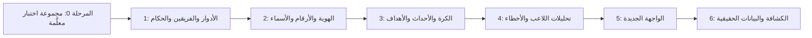
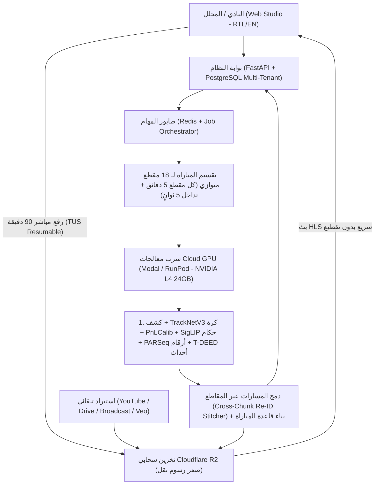
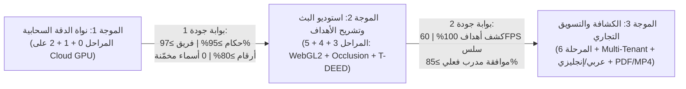
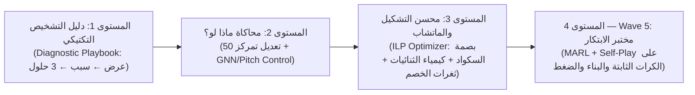
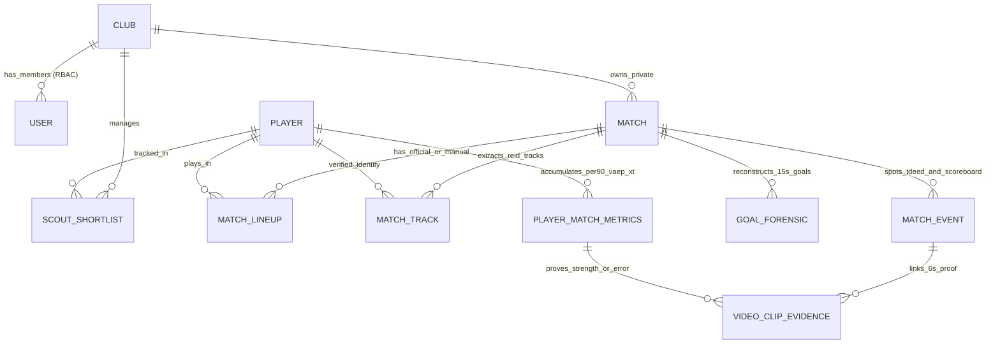
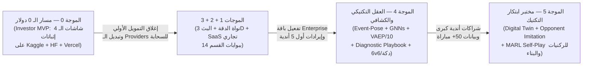

# الخطة الشاملة لإعادة بناء EGY-SCOUT (V8) — قبل كتابة أي كود

> [!IMPORTANT]
> لن يُكتب أي كود قبل موافقتك على هذه الخطة والإجابة على الأسئلة في القسم الأخير. الهدف: منتج تعتمد عليه الأندية في الشراء والتدريب، لا عرض شكلي.

---

## 1. التشخيص الصريح للوضع الحالي (ما هو حقيقي وما هو غير موثوق)

| المكوّن | الحالة الفعلية | الحكم |
|---|---|---|
| معايرة الملعب PnLCalib | خطأ 1.9–3.6 بكسل، تغطية 78–97% | ✅ قوي — نحتفظ به |
| كشف اللاعبين YOLO | جيد للاعبين، **ضعيف في تمييز الحكام** | ⚠️ يحتاج استبدال |
| فصل الفريقين | ألوان قمصان (11 قيمة) + KMeans على فريقين فقط | ❌ سبب مشكلة الحكم |
| الأسماء التلقائية | مطابقة حسب **المركز فقط** (0–3 أرقام OCR لكل مباراة) | ❌ تخمين — مضلل ويجب إيقافه |
| تحليل الأهداف | المقاطع 25–75 ثانية بلا أهداف فعلية؛ كل الـ xG = 0.03 | ❌ لا يوجد كشف أحداث حقيقي |
| أخطاء/مميزات اللاعبين | قواعد بعتبات افتراضية غير مُختبرة | ⚠️ غير مُعايَر على بيانات حقيقية |
| قاعدة الكشافة (536 لاعب) | أسماء حقيقية لكن **قيم الـ 14 مقياس مولّدة (seed)** | ❌ لا تصلح لقرار شراء |
| الواجهة | وظيفية لكن مزدحمة، وأداء الرسم ثقيل | ⚠️ تحتاج إعادة تصميم |

### دليل مشكلة الحكم (من بياناتك الفعلية — الأهلي × إنبي، فريم 1250)
- `track 9`: لون القميص `RGB(226,255,203)` (فاتح/فسفوري = طقم حكم) → صُنِّف **لاعب إنبي** بثقة 0.15 فقط.
- `track 20`: مساعد حكم على خط التماس `y = -0.26م` → صُنِّف **لاعب إنبي**.
- **السبب الجذري:** YOLO يسمّي الحكم «player»، ثم KMeans مُجبَر على وضع كل شخص في أحد فريقين فقط، ولا يوجد «فئة ثالثة» للحكام ولا رفض للثقة المنخفضة.

---

## 2. البحث: ما الذي تستخدمه الأنظمة الاحترافية فعلاً؟

| المهمة | الأفضل المتاح مفتوح المصدر | ملاحظة |
|---|---|---|
| خط المعالجة الكامل | **SoccerNet Game State Reconstruction (`sn-gamestate` / TrackLab)** | مرجع أكاديمي يجمع: كشف + تتبع + دور (لاعب/حارس/حكم) + فريق + رقم قميص + معايرة |
| فصل الفريقين | **SigLIP embeddings + UMAP + KMeans** (موجود في `open_source_engines/sports` عندك) | أدق بكثير من ألوان القمصان، يتحمل الإضاءة والظلال |
| الحكام | تصنيف 3 فئات (فريق أ / فريق ب / حكام) + قاعدة خط التماس + تصويت على مستوى المسار | يحل مشكلتك مباشرة |
| أرقام القمصان | نماذج **PARSeq / Jersey-Number-Recognition** من تحدي SoccerNet 2023–2024 + تصويت عبر المسار | الأرقام تُقرأ عبر عشرات اللقطات لا لقطة واحدة |
| إعادة التعرّف Re-ID | **PRTReid / OSNet** | يقلل تكرار نفس اللاعب بهويات متعددة |
| الكرة | كاشف كرة مخصص + **SAHI tiling** + تتبع كالمان | الكرة صغيرة جداً في البث الواسع |
| الأهداف والأحداث | **قراءة لوحة النتيجة (Scoreboard OCR)** لكشف تغيّر النتيجة + **SoccerNet Action Spotting** (هدف/تسديدة/بطاقة/ركنية) | هذا ما يجعل «تحليل الهدف» حقيقياً |
| بيانات الكشافة | استيراد CSV من مزوّد بيانات (Wyscout / InStat / Opta) **أو** بيانات تُولد من فيديوهاتكم فقط | لا قيم مُخترَعة |

> [!WARNING]
> **قيد الجهاز:** جهازك يعمل بالمعالج فقط (بدون كارت NVIDIA). نماذج SigLIP / PARSeq / Action Spotting على CPU تعني ~1–3 ساعات معالجة لكل 10 دقائق فيديو. البديل: معالجة سحابية على GPU (Colab / Modal / RunPod) بتكلفة تقريبية بسيطة لكل مباراة. **هذا قرار يحتاج موافقتك.**

---

## 3. المبادئ الحاكمة للنسخة الجديدة
1. **لا اسم بدون دليل:** الاسم يظهر فقط إذا (أ) أكّده المستخدم، أو (ب) قُرئ الرقم بثقة عالية وطابق قائمة المباراة الرسمية. غير ذلك يظهر «لاعب #؟ — إنبي».
2. **لا حدث بدون دليل:** «هدف» = تغيّر في لوحة النتيجة أو حدث مكتشف بثقة عالية. لا تسمية «هدف» لهجمة عادية.
3. **كل رقم معه حجم العينة ومستوى الثقة.**
4. **قياس الدقة قبل العرض:** كل وحدة لها مقياس ونسبة نجاح مطلوبة على بيانات معلَّمة يدوياً.

---

## 4. مراحل التنفيذ



### المرحلة 0 — مجموعة اختبار معلَّمة (أساس كل شيء)
- تعليم ~300 فريم من المباريات الثلاث: دور كل شخص (لاعب/حارس/حكم/مساعد)، الفريق، رقم القميص إن ظهر.
- أداة تعليم بسيطة داخل البرنامج نفسه (تُستخدم لاحقاً لتصحيح أي مباراة).
- **الناتج:** نقيس عليها كل تحسين بالأرقام بدلاً من الانطباع.

### المرحلة 1 — الأدوار والفريقين والحكام (يحل مشكلتك الأساسية)
- استبدال فصل الألوان بـ **SigLIP + UMAP + KMeans بثلاث فئات** (فريق أ، فريق ب، حكام/آخرون).
- قواعد إضافية: من يقف على خط التماس (`y<1.2م` أو `y>66.8م`) أو يرتدي لوناً مختلفاً عن الفريقين = حكم مساعد/حكم.
- تصويت على مستوى المسار الكامل (لا يتغير دور الشخص من فريم لآخر).
- **معيار القبول:** دقة تصنيف الحكام ≥ 95%، دقة الفريق ≥ 97% على مجموعة الاختبار.

### المرحلة 2 — الهوية والأرقام والأسماء
- **قائمة المباراة الرسمية** (11 أساسي + احتياط بالأرقام) تُدخل يدوياً أو تُستورد — هذا هو المصدر الموثوق للأسماء.
- قراءة الأرقام بنموذج متخصص + تصويت عبر كل لقطات المسار.
- Re-ID لدمج مسارات نفس اللاعب.
- شاشة تأكيد سريعة: صور اللاعبين المقصوصة + الرقم المقروء + الاسم المقترح ← تأكيد/تعديل.
- **معيار القبول:** نسبة قراءة الأرقام الصحيحة ≥ 80% للاعبين الظاهرين ≥ 10 ثوانٍ؛ صفر أسماء بدون دليل.

### المرحلة 3 — الكرة والأحداث والأهداف الحقيقية
- كاشف كرة محسّن (SAHI) + تتبع مستمر.
- قراءة لوحة النتيجة والوقت من البث (OCR) → كشف الأهداف تلقائياً بالدقيقة.
- كشف الأحداث: تسديدة، ركنية، تسلل، بطاقة، تبديل.
- **تحليل الهدف الحقيقي:** إعادة بناء آخر 15–20 ثانية قبل الهدف: من بدأ الهجمة، التمريرات، من أخطأ في التغطية، موقع كل مدافع لحظة التسديد.
- **معيار القبول:** كشف 100% من تغيّرات النتيجة في المباريات الكاملة؛ دقة الأحداث ≥ 85%.

### المرحلة 4 — تحليلات اللاعب والأخطاء (معايَرة)
- إعادة تعريف الأخطاء بمعايير تدريبية متفق عليها معك (أو مع مدرب): ترك الرقابة، التأخر في الارتداد، فقدان الكرة، كسر خط التسلل…
- معايرة العتبات على مقاطع يراجعها مدرب حقيقي (صح/غلط) قبل الاعتماد.
- تقرير لكل لاعب: مميزات، عيوب، لقطات فيديو مرتبطة، مقارنة بمتوسط مركزه.

### المرحلة 5 — الواجهة الجديدة
- إعادة تصميم كاملة بنظام تصميم واحد وتدفق بسيط: **مباراة ← لاعبين ← لحظات ← تقرير**.
- تحسين الأداء: رسم الطبقات عبر WebGL أو تخزين مسبق للطبقات، وتحميل تليميتري تدريجي.
- مراجعة مرجعية: تحتاج منك أمثلة لما تريده (لقطات من Hudl / Wyscout / SkillCorner / البث).

### المرحلة 6 — الكشافة والبيانات الحقيقية
- إزالة القيم المولّدة من قاعدة الـ 536 لاعب أو وسمها بوضوح «تقديرية».
- بناء ملف اللاعب من فيديوهاته المحلّلة فقط (تراكمي عبر المباريات).
- دعم استيراد CSV من مزوّد بيانات إن توفر للنادي.

---

## 5. الجدول الزمني التقريبي

| المرحلة | المدة التقريبية | تعتمد على |
|---|---|---|
| 0 — مجموعة الاختبار | 1–2 جلسة | وقت تعليم يدوي (أنا أبني الأداة، والتعليم نتقاسمه) |
| 1 — الحكام والفريقين | 1–2 جلسة | تحميل نماذج SigLIP (~1.5 جيجا على D:) |
| 2 — الأرقام والأسماء | 2 جلسات | قائمة مباراة رسمية |
| 3 — الأحداث والأهداف | 2–3 جلسات | **فيديوهات أطول تحتوي أهدافاً فعلية** |
| 4 — تحليلات اللاعب | 2 جلسات | مراجعة مدرب |
| 5 — الواجهة | 2–3 جلسات | أمثلة مرجعية منك |
| 6 — الكشافة | 1–2 جلسة | مصدر بيانات |

---

## 6. أسئلة أحتاج إجاباتها قبل البدء
1. **المعالجة:** نكمل على المعالج المحلي (بطيء لكن مجاني)، أم نستخدم GPU سحابي (أسرع بكثير، تكلفة بسيطة لكل مباراة)؟
2. **الفيديوهات:** هل ستحلّلون مباريات كاملة (90 دقيقة) أم مقاطع؟ هل يمكنك توفير مباراة كاملة أو مقاطع فيها أهداف فعلية للاختبار؟
3. **الأسماء:** هل توافق أن يكون مصدر الأسماء **قائمة المباراة الرسمية** (تُدخل مرة واحدة لكل مباراة في دقيقة) مع قراءة الأرقام تلقائياً؟ هذا هو الطريق الوحيد الموثوق.
4. **الشكل المطلوب:** ما المثال الأقرب لما تتخيله؟ (أرسل صوراً أو روابط لبرنامج/بث يعجبك).
5. **بيانات الكشافة:** هل لدى الأندية المستهدفة اشتراك في Wyscout / InStat؟ أم نعتمد فقط على ما نستخرجه من الفيديو؟
6. **الأولوية:** هل نبدأ بالمرحلة 1 (الحكام والفريقين) فوراً بعد مجموعة الاختبار؟


---
---

# التوسعة والتطوير الشامل للخطة (إضافات V8 Pro — منتج تجاري جاهز للبيع للأندية)

> [!NOTE]
> **الالتزام الكامل بالخطة الأصلية:** الأقسام (1 إلى 6) أعلاه محفوظة كما هي حرفياً دون أي تعديل. ما يلي هو **توسعة هندسية وبصرية وتجارية شاملة** مبنية مباشرة على قراراتك الستة لتحويل المنصة إلى منتج احترافي بمستوى تحليلات الدوري الإنجليزي والإسباني وجاهز للبيع للأندية الكبرى.

---

## 7. القرارات المعتمدة من مالك المشروع (Decision Lock)

| المحور | القرار المعتمد | الأثر الهندسي والتجاري المباشر |
|---|---|---|
| **1. البنية الحاسوبية** | **كارت شاشة سحابي (Cloud GPU)** | معالجة مباراة كاملة 90 دقيقة في 6–9 دقائق فقط بتكلفة ~\$0.40–\$0.80 للمباراة مع تسعير بالثانية (Scale-to-Zero). |
| **2. مصدر الفيديوهات** | **الاثنان معاً (رفع يدوي + استيراد تلقائي)** | دعم رفع ملفات 90 دقيقة (حتى 8 جيجا) + استيراد تلقائي من روابط البث / يوتيوب / Drive / كاميرات Veo وHudl. |
| **3. أسماء اللاعبين** | **الاثنان معاً (قائمة رسمية + قراءة أرقام تلقائية)** | سحب التشكيلة تلقائياً من API أو رفع/لصق ورقة المباراة + قراءة أرقام القمصان بـ PARSeq عبر عشرات اللقطات؛ مع قاعدة صارمة: لا يُعرض اسم بدون دليل. |
| **4. المستوى البصري والواجهة** | **مستوى البث الأوروبي (Premier League / LaLiga / Sky Sports MNF)** | محرك WebGL2 بسرعة 60FPS، إخفاء الطبقات خلف أرجل اللاعبين (Chroma-Key + Occlusion)، وأدوات رسم تفاعلي للمحلل (SkyPad Telestrator). |
| **5. بيانات الكشافة** | **الاثنان معاً (بيانات من فيديوهاتنا + استيراد مزوّدين)** | النادي الذي لا يملك اشتراك Wyscout يبني قاعدة لاعبيه من الفيديو 100%، والنادي المشترك يستورد ملفات Wyscout / InStat / Opta بضغطة زر. |
| **6. النموذج التجاري** | **منتج SaaS جاهز للبيع للأندية** | تعدد الأندية (Multi-Tenant)، صلاحيات (مدرب / محلل / كشاف / إدارة / لاعب)، دعم عربي/إنجليزي للمدربين الأجانب، وتصدير تقارير PDF وMP4 بشعار النادي. |

---

## 8. البنية السحابية الاحترافية واقتصاديات التشغيل (Cloud GPU Architecture & Cost Model)



### لماذا هذه البنية هي الأنسب تجارياً؟
1. **المعالجة المتوازية (`Map-Reduce Video Chunking`):** بدلاً من معالجة مباراة 90 دقيقة على كارت واحد في 60–90 دقيقة، يُقسم الفيديو تلقائياً إلى 18 شريحة (كل شريحة 5 دقائق مع تداخل 5 ثوانٍ لربط الهويات) وتُعالج بالتوازي على معالجات **NVIDIA L4 (24GB VRAM)** خلال **6 إلى 9 دقائق فقط**.
2. **التكلفة الفعلية للمباراة الكاملة (90 دقيقة — أسعار Modal / RunPod لعام 2026):**
   - سعر كارت **NVIDIA L4** السحابي: **~\$0.80 / ساعة** (يُحسب بالثانية فقط أثناء العمل، و\$0 عند التوقف).
   - استهلاك مباراة كاملة 90 دقيقة (مجموع وقت الـ GPU عبر كل النماذج): **~0.45 إلى 0.75 ساعة GPU** = **\$0.36 – \$0.60 للمباراة**.
   - تحويل البث لـ HLS + تخزين Cloudflare R2 (بدون رسوم Egress): **~\$0.05 – \$0.10 للمباراة**.
   - **إجمالي التكلفة التشغيلية لمباراة كاملة 90 دقيقة: ~\$0.45 – \$0.75 فقط (~25 إلى 40 جنيهاً مصرياً)** — مما يمنحك هامش ربح تجاري ضخم عند بيع اشتراك شهري/سنوي للأندية.
3. **بث فيديو فوري بدون أي تقطيع (`GOP-Aligned HLS`):** تحويل كل مباراة مرفوعة تلقائياً إلى تدفق **HLS** بإطارات مفتاحية قصيرة (`keyint = 15 frames`)، فيصبح التقديم والترجيع فريم-بفريم والتشغيل البطيء (`0.1x / 0.25x / 0.5x`) فورياً تماماً مثل Hudl وWyscout.

---

## 9. التطوير العميق لخط الرؤية الحاسوبية (SOTA Computer Vision Pipeline)

يرتكز الخط الجديد على معمارية **SoccerNet Game State Reconstruction (`sn-gamestate` / TrackLab)** ويُقاس بمقياس **GS-HOTA** (الذي يعاقب أي خطأ في الدور أو الفريق أو الرقم باعتباره خطأً كاملاً):

### 9.1 مصنّف زوايا الكاميرا وعازل الإعادات (`Shot & Replay Gatekeeper`)
- قبل أي حسابات، يصنّف نموذج خفيف كل لقطة إلى: `كاميرا تكتيكية واسعة` | `لقطة قريبة Close-Up` | `إعادة تلفزيونية Replay` | `خلف المرمى` | `جمهور/إحصائيات`.
- **أهمية عزل الإعادات:** يمنع احتساب نفس الهدف أو نفس السبرنت مرتين أثناء الإعادات التلفزيونية، لكنه **يستغل اللقطات القريبة والإعادات** كمصدر ذهبي لقراءة أرقام القمصان بوضوح فائق (100+ بكسل)!

### 9.2 درع منع تسرّب الحكام بـ 4 طبقات (`Zero-Referee-Leak Shield`)
القضاء النهائي على مشكلة ظهور الحكم أو مساعد الحكم ضمن اللاعبين:
1. **كاشف متخصص مدرب على `SN-GSR-2025` (`RT-DETR` / `YOLOv11x`):** يميّز 4 فئات مستقلة بدقة عالية: `player`، `goalkeeper`، `referee`، `ball`.
2. **فصل بصري عميق (`SigLIP + UMAP + 3-Class Clustering`):** استخراج بصمة بصرية عميقة لكل قميص (تتحمل الظل والشمس القوية في الملاعب المصرية) وتصنيفها إلى **3 مجموعات صريحة**: (فريق أ / فريق ب / حكام وشواذ). أي شخص ثقة انتمائه للفريقين أقل من `0.65` لا يُجبر أبداً على دخول فريق.
3. **القواعد الهندسية للحكم المساعد والخطوط:** أي مسار يتحرك بمحاذاة خط التماس (`y < 1.2م` أو `y > 66.8م`) أو خارج المستطيل الأخضر يُوسم تلقائياً كـ `assistant_referee` أو `staff` ويُستبعد نهائياً من التشكيل والتحليلات.
4. **تصويت المسار الكامل (`Track-Level Temporal Voting`):** الدور (لاعب / حارس / حكم) والفريق يُحسمان بالتصويت الموزون على كامل المسار، فيستحيل أن ينقلب الحكم إلى لاعب أو يتغير لون دائرة لاعب في منتصف الهجمة.

### 9.3 التتبع المتقدم للكرة (`TrackNetV3 + SAHI + Kalman Physics`)
- الكرة في البث الواسع حجمها `8–16` بكسل وتختفي مع الحركة السريعة (`Motion Blur`).
- ندمج **SAHI Tiling** (تقسيم الفريم لمربعات عالية الدقة) + نموذج **TrackNetV3** (الذي يقرأ 3–8 فريمات متتالية لرؤية مسار الكرة كخريطة حرارية) + مرحلة **Trajectory Rectification / Inpainting** لترميم مسار الكرة عند مرورها خلف اللاعبين، بالإضافة إلى تقدير **ارتفاع الكرة التقريبي (`3D Ball Arc`)** في الكرات الطولية والعرضيات عبر الفيزياء الباليستية.

### 9.4 نظام الهوية المزدوج (القائمة الرسمية + قراءة الأرقام المتخصصة)
- **المسار الأول — استيراد التشكيلة الرسمية تلقائياً أو يدوياً:**
  - ربط مباشر مع **API-Football / Sportmonks** لجلب تشكيلة الدوري المصري الممتاز وكأس مصر ودوري المحترفين تلقائياً (الأساسيين + الاحتياط + أرقام القمصان + التبديلات بدقائقها).
  - **قارئ ورقة المباراة (`Scoresheet OCR / Paste`):** للدرجات الثانية والثالثة غير المغطاة في الـ API، يصوّر المحلل ورقة التشكيل الرسمية أو يلصق 11 اسماً ورقماً في 30 ثانية.
- **المسار الثاني — قراءة الأرقام المتعددة (`Pose-Guided PARSeq + Legibility Gate`):**
  - بوابة وضوح (`Legibility Classifier`) تختار فقط الفريمات التي يظهر فيها ظهر/صدر اللاعب بزاوية صالحة (تتجاهل الفريمات الجانبية والضبابية).
  - نموذج **PARSeq** (الرائد في تحدي SoccerNet Jersey Recognition) يقرأ الرقم عبر **عشرات الفريمات** لكل مسار + تصويت موزّع الثقة + دمج المسارات بـ **PRTReid / OSNet**.
- **شاشة المراجعة السريعة (`2-Minute QA Sheet`):** تعرض لكل لاعب: 3 لقطات واضحة له + الرقم المقروء + نسبة الثقة + الاسم المطابق من ورقة المباراة؛ وبضغطة واحدة يؤكد المحلل أو يعدّل أي رقم قبل اعتماد التقرير النهائي.

### 9.5 الاستيراد التلقائي واليدوي للفيديوهات (`Hybrid Ingestion Hub`)
- **الرفع اليدوي:** دعم الملفات الضخمة (حتى 8 جيجا) مع استكمال الرفع عند انقطاع الإنترنت (`TUS Protocol`) واختيار تقسيم الشوط الأول/الثاني.
- **الاستيراد التلقائي الخارجي:** استيراد مباشر من روابط **Google Drive / Dropbox / OneDrive / YouTube / روابط بث القنوات / كاميرات التحليل التكتيكي (`Veo`, `Hudl`, `Spiideo`)** مع جدولة تلقائية لمعالجة مباريات الأسبوع بالكامل ليلاً.

---

## 10. استوديو البث والرسوم ثلاثية الأبعاد (معيار Premier League Oracle & LaLiga Beyond Stats & Sky Sports MNF)

هذا القسم يحدد الفارق البصري الجذري الذي يجعل العميل يشعر من أول ثانية أنه أمام منتج عالمي يُضاهي **Sky Sports Monday Night Football** و**LaLiga Beyond Stats**:

### 10.1 السر البصري الأول في البث الأوروبي: العزل اللوني للعشب وإخفاء الرسوم خلف اللاعبين (`Chroma-Key + Foreground Player Occlusion`)
- في الأنظمة العادية، تُرسم الخطوط والدوائر **فوق** أجسام اللاعبين فتبدو كملصقات رخيصة.
- في معمارية V8، نطبّق ترتيب الطبقات السينمائي المعتمد في **Vizrt / Chyron**:
  1. **طبقة 1:** فريم الفيديو الأصلي.
  2. **طبقة 2 — عزل العشب التكيّفي (`Adaptive Turf Key`):** يعزل العشب الأخضر حتى مع ظلال المدرجات القوية في الاستادات المصرية (الشمس والنصف المظلل).
  3. **طبقة 3 — الرسوم التكتيكية المنظورية 3D (`WebGL2 / PixiJS`):** حلقات أرضية، مساحات Pitch Control، جدار التسلل/الدفاع ثلاثي الأبعاد، أقواس التمرير، أشرطة المسافة بين المدافعين.
  4. **طبقة 4 — قناع اللاعبين الأمامي (`YOLOv11-seg / Foreground Matte`):** يُعاد رسم أجسام وأرجل اللاعبين **فوق** طبقة الرسوم، فتظهر الجرافيك وكأنها مرسومة فعلياً على نجيلة الملعب تحت أقدام اللاعبين!

### 10.2 لوحة المحلل التفاعلية (`SkyPad Tactical Telestrator` — مثل Sky Sports MNF)
- يوقف المدرب أو المحلل الفيديو عند أي لقطة ويستخدم شريط أدوات بث احترافي (مقفول بالمنظور الثلاثي الأبعاد على العشب):
  - **أداة الحلقة المضيئة والـ Spotlight 3D** على لاعب أو أكثر مع سحب كارت الإحصائيات اللحظي.
  - **أداة ربط خط الدفاع (`Linked Chain`):** تضغط على 4 مدافعين فتتصل بينهم سلسلة مضيئة تُظهر المسافات الفورية بالأمتار بين كل مدافعين وتومض بالأحمر عند تجاوز الحد التكتيكي.
  - **أداة قياس المسافة والسرعة (`3D Tape Measure`)** ورسم أسهم التحرك المنحنية 3D.
  - **أداة التعديل الافتراضي («ماذا لو؟» Virtual Ghost Move):** سحب نسخة شبحية شفافة من المدافع 4 أمتار لليسار لشرح التمركز الصحيح للاعبين في غرفة الملابس!
  - **تصدير مقطع فيديو بث كامل (`Export 1080p MP4 Broadcast Clip`):** يخرج المقطع بالرسوم والـ Telestration والصوت/التعليق الصوتي للمدرب جاهزاً للعرض على شاشة المحاضرات أو إرساله للاعبين.

### 10.3 حزمة جرافيك البث والبيانات المتقدمة (Premier League & LaLiga Standard)
- **التحكم الفيزيائي الديناميكي بالمساحة (`Spearman Dynamic Pitch Control`):** بدلاً من Voronoi الهندسي الساكن، يحسب خريطة احتمالية وصول كل فريق لأي نقطة في الملعب بناءً على **السرعة الحالية + اتجاه الجري + زمن وصول الكرة**.
- **مخطط زخم المباراة والخطورة الهجومية (`Oracle Match Momentum & Attacking Threat`):** يوضح فترات سيطرة كل فريق دقيقة بدقيقة مع ربط كل ذروة باللقطات المباشرة.
- **مخروط التسديد واحتمالية الهدف (`LaLiga Goal Probability Cone`):** يظهر زاوية المرمى المفتوحة، ظل تغطية المدافعين، مدى وصول الحارس، وقيمة `xG` و`PSxG` لحظة التسديد.
- **التوأم الميداني التفاعلي 3D + 2D (`Three.js / WebGL2 Twin`):** ملعب ثلاثي الأبعاد بحركة كاميرا حرة 360° (منظور البث / منظور المدرب / منظور عين اللاعب `Player-POV Camera` ليرى المدرب ما كان يراه اللاعب لحظة اتخاذ قرار التمرير!).

---

## 11. محرك الأحداث، تشريح الأهداف الحقيقي، والمقاييس الاحترافية (T-DEED + Goal Forensics)

### 11.1 الكشف الحقيقي عن الأهداف والأحداث (`Dual-Lock Event Spotting`)
- **القفل الأول — قارئ لوحة النتيجة والساعة (`Scoreboard OCR`):** يتتبع النتيجة والوقت (`00:00` إلى `90+`) باستمرار؛ أي تغيّر موثّق في النتيجة (مثل `0-0 ← 1-0`) يُثبت حدوث هدف حقيقي بالدقيقة والثانية.
- **القفل الثاني — نموذج `T-DEED` (`SoccerNet Ball Action Spotting`):** يرصد 12+ حدثاً زمنياً بدقة ثانية واحدة: `تمريرة`، `تمريرة عالية`، `عرضية`، `انطلاق بالكرة`، `رأسية`، `تسديدة`، `هدف`، `تدخل/تاكلينج`، `تشتيت`، `اعتراض`، `ركنية`، `ركلة حرة`، `رمية تماس` — مع ربط كل حدث بالفريق واللاعب المنفّذ.
- **محلل الكرات الثابتة (`Set-Piece Intelligence`):** يفصل تلقائياً كل الركنيات والركلات الحرة للخصم (تنظيم دفاع المنطقة vs رجل لرجل، نقطة السقوط المفضلة، اللاعب الهدف).

### 11.2 تشريح الهدف الكامل (آخر 15–20 ثانية — `Full Goal Forensics`)
لكل هدف حقيقي في المباراة، يبني النظام تقريراً مرئياً وتكتيكياً من 4 محاور:
1. **سلسلة التمريرات والبناء (`Pass Chain & xT Contribution`):** من افتك الكرة؟ كم تمريرة؟ كم ثانية استغرقت الهجمة؟ ومن رفع قيمة الخطورة المتوقعة (`ΔxT`)؟
2. **تشخيص نقطة الانهيار الدفاعي (بمعايير تدريبية دقيقة قابلة للضبط):**
   - **فقدان الرقابة في النقطة العمياء (`Blind-Side Run Lost`):** اتساع المسافة بين المدافع والمهاجم المنطلق بأكثر من `3.5م` خلال ثانيتين داخل الثلث الأخير.
   - **كسر مصيدة التسلل (`Broken Back-Line`):** سقوط أحد المدافعين بأكثر من `3.0م` خلف متوسط خط الدفاع.
   - **انكشاف المنطقة 14 / أنصاف المساحات (`Zone 14 Exposure`):** استلام الخصم في المنطقة 14 بدون أي ارتكاز ضمن نطاق `5م`.
   - **اختلال الدفاع الوقائي (`Rest-Defense Underload`):** تفوّق عددي للمهاجمين على المدافعين المتبقين أثناء التحول.
   - **زاوية تمركز الحارس (`GK Angle & Reach`):** انحراف الحارس عن منصف زاوية التسديد.
3. **قيمة التسديدة (`xG` و `Post-Shot xG`):** التمييز بدقة بين «هدف بسبب خطأ دفاعي فادح (`xG = 0.55`)» و«هدف من تسديدة خارقة أو خطأ حارس (`xG = 0.06`, `PSxG = 0.72`)».
4. **ملفات الأخطاء والمميزات الفردية لكل لاعب:** كل ميزة أو غلطة مرتبطة بمقطع 6 ثوانٍ حقيقي + مقارنة أداء اللاعب بمتوسط مركزه في الدوري + قائمة تشغيل تلقائية للاعب (`Player Clip Playlist`).

### 11.3 قاموس المقاييس العالمية المعتمدة في التقرير
- **البدني (`SkillCorner Standard`):** المسافة الإجمالية، الجري عالي الكثافة `HIR (19.8–25.2 كم/س)`، السبرنت `>25.2 كم/س`، أقصى سرعة، التسارعات والتباطؤات القوية `>3 م/ث²`، انطلاقات بدون كرة خلف الدفاع (`Runs in Behind`)، ومجهود الضغط.
- **التكتيكي والجماعي:** `xG`، `xA`، `xT`، **VAEP / OBV** (تقييم أثر كل لمسة في رفع احتمالية التسجيل أو منع الاستقبال)، التمريرات كاسرة الخطوط، الاستلام تحت الضغط، **PPDA** (شدة الضغط)، ميل الملعب (`Field Tilt %`)، الاستحواذ العالي (`High Turnovers`)، وتماسك الخطوط (`Compactness`).
- **مساعد المدير الفني الموثّق (Grounded Tactical Copilot):** يقرأ فقط الأرقام والأحداث الموثّقة ليولّد:
  - **ملخص ما بين الشوطين (3 نقاط سريعة في دقيقتين)** للمدرب.
  - **تقرير الخصم قبل المباراة (`Pre-Match Opponent Dossier`)** مجمّع من آخر 3–5 مباريات للخصم (كيف يسجلون؟ كيف يستقبلون؟ نقاط ضعفهم في الكرات الثابتة والانتقالات).

---

## 12. منظومة الكشافة الهجينة و Moneyball الدرجة الثانية (Dual-Source Scouting Engine)

لأن الأندية تختلف في ميزانياتها واشتراكاتها، يُبنى قسم الكشافة على **معمارية بيانات موحّدة (`kloppy`-Compatible Unified Schema)** تدعم المصدرين معاً:

1. **المسار الأول — ملف اللاعب المبني ذاتياً من فيديوهاتنا (بدون أي اشتراك خارجي):**
   - بمجرد رفع 3–5 مباريات لنادٍ في الدرجة الثانية أو الثالثة، يتجمع لكل لاعب سجل تراكمي حقيقي (أرقام لكل 90 دقيقة + خرائط حرارية + مقاطع فيديو لكل ميزة وعيب + معدل الأخطاء الدفاعية تحت الضغط).
   - **قاعدة الصدق:** يظهر بجانب كل رقم عدد الدقائق المحلّلة ومستوى الموثوقية (`< 180 دقيقة: عينة أولية` | `180–450 دقيقة: متوسطة` | `> 450 دقيقة: عالية`). ولا توجد أي أرقام مولّدة أو عشوائية.
2. **المسار الثاني — موصلات المزوّدين الخارجيين (`External Data Connectors`):**
   - استيراد مباشر لملفات **Wyscout (CSV/JSON)** و**InStat** و**Opta** و**StatsBomb**، ودمجها مع لقطات الفيديو المحلّلة في ملف واحد للاعب.
   - مزامنة البيانات الأساسية (العمر، النادي، المركز، انتهاء العقد، القيمة السوقية) عبر **API-Football / Sportmonks**.
3. **محرك قرار شراء لاعبي الدرجة الثانية (`Transfer Intelligence & Risk Engine`):**
   - **معامل التحويل بين الدرجات (`League-Strength Translation`):** يقيّم قدرة لاعب الدرجة الثانية على تحمل إيقاع وضغط الدوري الممتاز (خاصةً مؤشرات الاستلام تحت الضغط وسرعة اتخاذ القرار وشدة الجري `HIR`).
   - **ربط كل ادعاء كشفي بالفيديو (`Evidence-First Scouting`):** الضغط على أي ميزة أو تحذير في تقرير اللاعب يشغّل فوراً قائمة اللقطات المثبتة له (مثال: 5 لقطات لكسر الخطوط أو 4 لقطات لأخطاء التمركز).
   - **إدارة صفقات الكشافة (`Scouting CRM`):** قوائم مراقبة (`Shortlists`) حسب الميزانية والمركز، مقارنة 4 مرشحين جنباً إلى جنب، مصفوفة الملاءمة التكتيكية (`6 خطط × 4 أنظمة`) بأرقام حقيقية، وتصدير **ملف تعاقد تنفيذي PDF بشعار النادي** يُعرض مباشرة على رئيس النادي ولجنة الكرة.

---

## 13. جاهزية المنتج التجاري للبيع للأندية (Commercial B2B SaaS Blueprint)

لتحويل المشروع إلى منتج برمجي يُباع بعقود سنوية لأندية الدوري المصري والخليج العربي:

| المكوّن التجاري | التفاصيل المطلوبة للبيع الفعلي |
|---|---|
| **عزل الأندية والصلاحيات (`Multi-Tenant + RBAC`)** | مساحة مستقلة ومشفّرة لكل نادٍ بـ 5 أدوار: **مدير فني**، **محلل أداء**، **مدير كشافة**، **إدارة/لجنة كرة (عرض تقارير فقط)**، و**حساب اللاعب** (يشاهد مقاطعه الفردية وتدريباته فقط). |
| **ثنائي اللغة (`العربية RTL + الإنجليزية LTR`)** | تبديل فوري كامل للواجهة والتقارير — شرط أساسي لأن أغلب الأندية الكبرى (الأهلي، الزمالك، بيراميدز، أندية الخليج) تعمل بأجهزة فنية أجنبية ومحللين مصريين معاً. |
| **هوية النادي (`White-Label Exports`)** | وضع شعار النادي وألوانه تلقائياً على تقارير الـ PDF ومقاطع الفيديو المصدّرة (MP4) ومذكرات التعاقدات. |
| **وضع غرفة الملابس بدون إنترنت (`Locker-Room Offline Sync`)** | تنزيل مسبق لقوائم اللقطات وشرائح الـ Telestrator للعرض السلس داخل غرف الملابس بالاستادات ضعيفة الشبكة. |
| **أمن البيانات وحماية الفيديوهات (`Video DRM`)** | روابط فيديو موقّعة ومؤقتة الصلاحية، علامة مائية باسم النادي على الفيديوهات المصدّرة لمنع تسريب التدريبات والخطط، وسجل تدقيق (`Audit Log`). |
| **باقات البيع المقترحة للأندية (SaaS Tiers)** | **(1) باقة الدرجة الثانية والأكاديميات:** رفع وتحليل المباريات + بروفايلات اللاعبين.<br>**(2) باقة الفريق الأول Pro:** تحليل 90 دقيقة على Cloud GPU + استوديو 3D AR + SkyPad + تشريح الأهداف وتقارير الخصوم.<br>**(3) باقة مدير الكرة والكشافة Enterprise:** قاعدة مواهب الدرجة الثانية التراكمية + موصلات Wyscout/API + CRM صفقات + White-Label كامل. |

---

## 14. خارطة الإطلاق التجاري وبوابات الجودة الصارمة (3 Release Waves & Quality Gates)

ترتبط **المراحل (0 إلى 6)** من القسم 4 بثلاث محطات إطلاق تجاري واضحة، لا ننتقل من محطة للتالية إلا بعد اجتياز بوابات القياس:



| الموجة | النطاق | معيار النجاح الإلزامي قبل الانتقال |
|---|---|---|
| **الموجة 1 — نواة الدقة (Alpha)** | أداة التعليم + مجموعة اختبار 300 فريم + خط Cloud GPU (Modal/RunPod) + SigLIP 3-Class (فصل الحكام نهائياً) + PARSeq أرقام القمصان + ورقة التشكيلة الرسمية. | دقة الحكام **≥ 95%** • دقة الفريقين **≥ 97%** • دقة قراءة الأرقام **≥ 80%** • زمن معالجة 90 دقيقة **≤ 12 دقيقة** • **صفر** أسماء بدون دليل. |
| **الموجة 2 — البث وتشريح الأهداف (Beta Pilot)** | TrackNetV3 + SAHI للكرة + Scoreboard OCR + T-DEED للأحداث + تشريح الهدف 15–20ث + معايرة الأخطاء مع مدرب + واجهة WebGL2 جديدة بعزل العشب وإخفاء الطبقات خلف اللاعبين + SkyPad Telestrator. | كشف **100%** من أهداف المباريات الكاملة • دقة الأحداث **≥ 85%** • تشغيل **60FPS** سلس على فيديو HLS • تجربة ميدانية حقيقية مع محلل/مدرب. |
| **الموجة 3 — المنتج التجاري (V1.0 Launch)** | قاعدة الكشافة التراكمية من الفيديو + موصلات Wyscout/InStat/API-Football + معامل التحويل للدرجة الثانية + Multi-Tenant RBAC + عربي/إنجليزي + تصدير PDF/MP4 بشعار النادي. | جاهز للتجربة المجانية مع أول 3 أندية وإغلاق أول عقد اشتراك تجاري. |

---

> [!TIP]
> **الخطوة التالية (عندما تقرر البدء):** الخطة الآن مكتملة ومجمّدة تماماً بدون أي كود جديد. متى أردت البدء في التنفيذ، قولي فقط **"ابدأ المرحلة 0 (مجموعة الاختبار وإعداد Cloud GPU)"** وسنبدأ بها خطوة بخطوة مع قياس كل رقم بدقة، وإذا أردت إضافة أي فكرة أو ميزة أخرى على هذه الخطة قبل البدء فأخبرني لأضيفها بنفس الأسلوب.


---
---

# التوسعة الاستراتيجية الشاملة (V8 Ultra — الذكاء التكتيكي، الكشافة العادلة، المرونة الشاملة، ومسار المستثمرين بـ \$0)

> [!IMPORTANT]
> **الالتزام الحرفي بعدم المساس بما سبق:** الأقسام (**1 إلى 14**) أعلاه محفوظة كما هي تماماً دون حذف أو تعديل حرف واحد. الأقسام الجديدة (**15 إلى 21**) تُضيف الطبقة الفائقة للمشروع (V8 Ultra): العقل التكتيكي واقتراح الخطط والابتكار بالمحاكاة، تقييم قرارات اللاعب والمقارنة العادلة، دعم كل الصيغ من **6 ضد 6 والبراعم حتى 11 ضد 11 بالدكة والتغييرات**، المخطط البرمجي الكامل للنظام وقاعدة البيانات، دراسة السوق والمخاطر، و**مسار الإطلاق الصفري بـ 0 جنيه (Zero-Budget Investor MVP)** لجذب التمويل قبل الإنفاق السحابي.

---

## 15. طبقة الذكاء السياقي وتقييم القرارات الفردية والمقارنة العادلة (Player DNA & Fair Scouting Engine)

الهدف هنا نقل المنصة من «إحصائيات حركة وأحداث» إلى **عقل كشافي يفهم قرارات اللاعب ويقيّمه بعدالة مطلقة دون ظلم** حتى لو كان يلعب في فريق ضعيف أو في الدرجة الثانية.

### 15.1 المكوّنات الخمسة الجديدة والضوابط الهندسية لمنع تضخم التكلفة أو الهلوسة

| المكوّن | الأداة المفتوحة المصدر | الضابط الهندسي الحرج (Production Guardrail) | القيمة للمدرب والكشاف |
|---|---|---|---|
| **1. وضعية الجسم وفحص المساحات (`Pose & Scanning`)** | `RTMPose` / `HRNet` | **تشغيل انتقائي بالأحداث فقط (`Event-Triggered`):** يعمل فقط في نافذة `±2` ثانية حول لحظة الاستلام/التمرير/التسديد (يوفر ~90% من وقت الـ GPU). مع **بوابة دقة (`Resolution Gate`)**: تُحسب وضعية الجذع (`Torso Open/Closed`) في البث العادي، ولا يُحسب `Head Scanning` إلا عند ارتفاع اللاعب `>= 75px` أو في 4K/اللقطات القريبة. | يكشف هل اللاعب يستلم بجسم مفتوح للملعب وهل يمسح المساحة حوله قبل وصول الكرة. |
| **2. تقييم قيمة كل لمسة (`Action Valuation`)** | مكتبة `socceraction` (`VAEP` + `xT`) + `floodlight` | تُبنى وتُعايَر مبكراً بالتوازي مع الموجة 1 على بيانات **StatsBomb Open Data + SkillCorner Open Data** عبر `kloppy` كبيئة اختبار جاهزة قبل اكتمال خط الرؤية. | يقيّم كل تمريرة أو مراوغة أو قطع كرة بناءً على أثرها الفعلي في رفع احتمال التسجيل أو منع استقبال هدف. |
| **3. فهم التحرك بدون كرة (`Off-Ball GNNs`)** | `PyTorch Geometric (PyG)` | **وضعان للتشغيل لحل غياب اللاعبين خارج الكادر:** (أ) `Local Sub-Graph` في البث التلفزيوني العادي (يربط اللاعبين الظاهرين في محيط الكرة فقط)، و(ب) `Full 22-Node GNN` مع كاميرات الملعب الكامل (`Veo / Spiideo / Tactical Cam`). | يقيس سحب المدافعين وفتح قنوات التمرير ومساحة السيطرة حتى في الـ 87 دقيقة التي لا يلمس فيها اللاعب الكرة. |
| **4. محرك التقييم الموحد من 10 حسب المركز** | `Position-Weighted Rating Engine` | معادلة أوزان شفافة ومخصصة لكل مركز (`GK / CB / FB / DM / CM / AM / W / ST`) تدمج `VAEP` + `xT` + الدقة تحت الضغط + التحرك بدون كرة + الالتزام الدفاعي + الانضباط المكاني. | رقم واضح ومفهوم للمدرب (`7.8 / 10`) مع تفكيك كامل لسبب الدرجة. |
| **5. كاتب التقارير البصري الموثّق (`Hybrid Grounded VLM`)** | `Qwen2.5-VL` (أو Gemini Vision في الـ Demo) | **ممنوع التخمين من الفيديو وحده:** يُرسَل للنموذج المقطع القصير (`6 ثوانٍ`) + ملف JSON الموثّق (`T-DEED` + `VAEP` + المسافات بالأمتار) ليصف اللقطة بصرياً ويكتب التقرير بناءً على الدليلين معاً فقط (**صفر هلوسة**). | تقرير كشافي نصي احترافي بالعربية والإنجليزية مرتبط مباشرة بمقاطع الفيديو. |

### 15.2 بوابة الأوضاع الثلاثة لحماية العدل ومقاومة «فخ الملخصات» (`3-Mode Input Gate`)
تكتشف المنصة نوع الفيديو المرفوع تلقائياً (المدة + معدل تقطيع اللقطات + تسلسل ساعة لوحة النتيجة) وتفرض قواعد عدالة صارمة:

1. **وضع لقطات الأهداف (`Goal Clips Mode`):** يُشغّل **تشريح الهدف (Goal Forensics)** وتحديد أخطاء التغطية واقتراح الحل التكتيكي فقط — **ولا يُنتج تقييماً عاماً للاعب ولا يُدخله في ترتيب الكشافة**.
2. **وضع الملخصات وفيديوهات الوكلاء (`Highlights / Player Reel Mode`):** يُشغّل **فحص المهارات الدقيقة (`Micro-Mechanics Audit`)** (جودة الاستلام ووضعية الجسم، سرعة القرار في الثلث الأخير، تنوع الإنهاء)، ويطبع شارة تحذير واضحة: *"عينة منتقاة — لا تقيس الالتزام الدفاعي أو الاستمرارية؛ يُنصح برفع 3 مباريات كاملة قبل التعاقد"*.
3. **وضع المباريات الكاملة (`Full Match Scouting Mode — المعيار العادل`):** هنا فقط يُفتح محرك الكشافة الكامل والمقارنة العادلة بين المواهب لأنه يرى الـ 90 دقيقة كاملة (بالكرة وبدون كرة).

### 15.3 القواعد الأربع الذهبية للمقارنة العادلة بين المواهب (`Zero-Bias Talent Comparison`)
- **فصل «النمط» عن «الجودة» (`Player DNA / Archetypes`):** يصنّف النظام أسلوب اللاعب تلقائياً (مثلاً: مهاجم محطة vs مهاجم مساحات، ارتكاز قاطع كرات vs صانع لعب عميق) ويقارنه بنظرائه أو يشرح للنادي أي نمط يخدم خطة المدرب بدلاً من ظلم لاعب على حساب أسلوب مختلف.
- **التعديل السياقي حسب استحواذ الفريق (`PAdj — Possession-Adjusted`) ونسبة المساهمة:** تُعدَّل الأرقام الدفاعية حسب نسبة استحواذ فريق اللاعب، وتُقاس المساهمة الهجومية كنسبة من إجمالي خطورة فريقه (`% of Team VAEP/xT`) حتى لا يُظلم لاعب موهوب في فريق دفاعي بوسط أو قاع الدرجة الثانية.
- **مقياس الثقة وفصل الجودة عن الحظ (`Anti-Luck & Sample Size`):** عرض الدقائق المحللة بوضوح والفصل الصريح بين الأداء التكتيكي الحقيقي (`VAEP / xG / سحب المدافعين`) وبين الحظ العشوائي في تسجيل أو إهدار فرصة واحدة.
- **مبدأ «كل رقم قصاده فيديو» (`Evidence-First Comparison`):** في شاشة مقارنة المواهب، الضغط على أي ميزة أو عيب يشغّل فوراً قائمة تجميعية (`Auto-Playlist`) بآخر 5 لقطات إثباتاً للحكم، ليبقى قرار التعاقد إنسانياً وعادلاً 100%.

---

## 16. محرك اقتراح الخطط والتشكيل ومختبر ابتكار التكتيك (Tactical Decision & Innovation Engine)

بدلاً من النصائح العامة الإنشائية، يُبنى عقل اقتراح الحلول والخطط على **4 مستويات تصاعدية** تراعي «سيكولوجية المدرب» (يعرض 3 سيناريوهات مدعومة بالأرقام والفيديو ويترك القرار للمدرب):



### المستوى 1 — دليل التشخيص التكتيكي (`Diagnostic Playbook` مُعايَر مع مدربين)
ربط كل خلل رقمي مكتشف في الفيديو بـ 3 بدائل تكتيكية عملية (محافظ / متوازن / هجومي) مع ذكر **المخاطرة المقابلة لكل حل**:
- *استقبال الخصم في المنطقة 14 > 6 مرات بدون ارتكاز ضمن 5م* ← التحول لارتكاز مزدوج (`4-2-3-1`) أو تضييق عرض قلبي الوسط إلى `< 12م`.
- *انكشاف الدفاع الوقائي خلف الظهير المتقدم (`Rest-Defense Underload`)* ← تفعيل الظهير المقلوب (`Inverted Fullback`) في الجهة العكسية لتثبيت 3 لاعبين في الخلف أو خفض الخط 7 أمتار عند غياب الضغط على الكرة.
- *فشل البناء تحت ضغط عالٍ (`PPDA الخصم < 8`)* ← إنزال رقم 6 بين قلبي الدفاع (`Salida Lavolpiana`) لخلق تفوق `3 ضد 2` أو اللعب المباشر خلف الظهير المندفع.

### المستوى 2 — محاكاة «ماذا لو؟» الحسابية (`Counterfactual Tactic Optimizer` — مستوحى من DeepMind TacticAI)
- في أي هدف مُستقبَل أو ركنية خطيرة، يختبر المحرك آلياً **50 تعديلاً افتراضياً** لموقع مدافع أو مدافعين في نطاق `2–5` أمتار، ويعيد حساب `Spearman Pitch Control` و`xG` لكل سيناريو.
- يعرض للمدرب التعديل الأعلى أثراً كحركة شبحية (`Virtual Ghost Move`) على الملعب: *"لو غطى المدافع #4 زاوية التمرير `3.2م` للداخل، تنخفض سيطرة الخصم داخل الصندوق من `64%` إلى `21%`"*.

### المستوى 3 — محرّك اقتراح التشكيلة والـ 11 لاعباً والتبديلات (`Squad & Matchup Optimizer`)
يعمل بـ 4 طبقات حسابية قبل المباراة:
1. **متجه قدرات كل لاعب (`Player Capability Vector`):** السرعة، مقاومة الضغط (`VAEP` تحت الضغط)، التفوق الهوائي، وحمل الإرهاق من آخر 3 مباريات.
2. **خريطة الكيمياء والتفاهم (`Synergy Graph` عبر GNN):** يقيس تفاهم الثنائيات (مثلاً: الجبهة اليسرى بين الظهير #21 والجناح #7 تنتج `xT` أعلى بنسبة `35%` من ثنائية أخرى).
3. **بصمة ثغرات الخصم (`Opponent Vulnerability Vector`):** تجميع آخر 3–5 مباريات للخصم (مصادر الأهداف المستقبلة، بطء التحولات، ضعف الكرات الثابتة).
4. **حلّال التحسين المقيّد (`ILP / Genetic Constrained Solver`):** يراعي الإصابات والإيقافات والإرهاق ليقترح أفضل خطتين وتشكيلتين مع **خطة تبديلات زمنية** (مثلاً: استغلال هبوط سرعة ظهير الخصم بعد الدقيقة 60 بورقة جناح سريع).

### المستوى 4 (الموجة 5 — `Wave 5 Tactical Innovation Lab`) — ابتكار تكتيك لم يُنفّذ من قبل (`MARL + Self-Play`)
لأن النماذج اللغوية (`LLMs`) تعيد تركيب ما درسته فقط ولا تبتكر جديداً، يُبنى «مصنع الابتكار» على 4 خطوات علمية حقيقية تبدأ **بالمواقف قصيرة المدة (10–15 ثانية)** لجدواها الحاسوبية العالية:
1. **ملعب محاكاة فيزيائي 2D سريع (`Digital Twin Sandbox` / فوق `gfootball` أو محرك كينماتيكي مخصص):** يُغذَّى بقدرات لاعبيك ولاعبي الخصم الحقيقية المستخرجة من الفيديو.
2. **استنساخ سلوك الخصم (`Opponent Imitation Learning` عبر GNN):** تدريب وكلاء الخصم ليتصرفوا بنفس ردود فعل الخصم الفعلي (ارتفاع خطه، لحظة ضغطه، تنظيم ركنياته).
3. **اللعب الذاتي متعدد الوكلاء (`MAPPO / MARL Self-Play`):** تشغيل 10,000–100,000 محاكاة في 3 مواقف ذات أعلى عائد تكتيكي: **(أ) الكرات الثابتة والركنيات، (ب) أنماط الخروج من ضربة المرمى تحت الضغط، (ج) مصايد الضغط العالي (`Pressing Traps`)**.
4. **فلتر الواقعية البشرية (`Human-Realism Constraints`):** فرض زمن رد فعل بشري (`~250ms`)، مخروط رؤية محدود، ونسبة خطأ تمرير واقعية لكل لاعب؛ ثم عرض الروتين المبتكر كأنيميشن 3D/2D مع دليل إحصائي (مثلاً: رفع احتمال التسجيل في 10,000 محاكاة من `4%` إلى `13.5%`).

---

## 17. المرونة العالمية الشاملة: من 11×11 بالتغييرات والدكة إلى الشباب والـ 6×6 ومعايير FIFA

لفتح سوق **الأكاديميات وقطاعات الناشئين والمدارس الكروية** (وهو أكبر عدداً بعشرات الأضعاف من أندية الدوري الممتاز) مع الحفاظ على دقة الفريق الأول:

### 17.1 معالج إعداد المباراة والتحديد اليدوي الفائق (`Match Setup Wizard + SAM 2 Pinning`)
قبل المعالجة (في 10 ثوانٍ فقط) يختار المستخدم:
- **صيغة اللعب وعدد اللاعبين:** `11v11` | `9v9` | `7v7` | `6v6` | `5v5` | أو عدد مخصص.
- **الفئة العمرية:** فريق أول (`Senior`) | شباب (`U18–U21`) | ناشئين (`U13–U17`) | براعم (`U7–U12`).
- **وضع اختيار اللاعبين (تلقائي أو يدوي بـ `SAM 2`):** بجانب التتبع التلقائي، يقدر المدرب يضغط كليك على اللاعبين في الفريم الأول لتقسيمهم (فريق أ / فريق ب / حراس / تجاهل) فيتتبعهم **Meta SAM 2** بدقة حتى في تمارين «الفستات» (`Bibs`) أو مباريات الأطفال بدون أرقام قمصان، مع الاستفادة من `SAM 2` أيضاً في قص حواف اللاعبين بجودة سينمائية لطبقة الإخفاء (`Foreground Occlusion`).

### 17.2 محرك الدكة والتغييرات والطرد (`Bench & Substitution State Manager`)
- **عزل الدكة ومنطقة الإحماء تلقائياً:** أي شخص خارج حدود المستطيل الأخضر يُوسم تلقائياً كـ `Bench / Warm-up` ويُستبعد نهائياً من التشكيل وخرائط المساحات.
- **سقف اللاعبين النشطين والتبديلات:** يلتزم المحرك بسقف الصيغة (`11` أو `6` إلخ)، ويرصد التغييرات من القائمة الرسمية أو حركة الخروج/الدخول عند خط التماس أو زر المحلل، ويوقف عداد دقائق اللاعب الخارج فوراً ليبقى حساب أرقامه لكل 90 دقيقة عادلاً 100%.
- **التغييرات المفتوحة (`Rolling Substitutions`) والطرد:** في `5v5 / 6v6 / الأطفال` يحسب إجمالي الدقائق النشطة داخل الملعب (`On-Pitch Minutes`) مهما تكرر دخول وخروج اللاعب، وفي حالة الطرد بـ `11v11` يخفض سقف الفريق تلقائياً إلى `10`.

### 17.3 المعايرة البديلة والعتبات المكيّفة مع السن (`Small-Sided & Age-Scaled Engine`)
- **معايرة 4 نقاط للملاعب الصغيرة (`4-Point Homography Fallback`):** عند غياب الخطوط القانونية (ملعب خماسي أو تقسيمة بأقماع)، يضغط المستخدم على 4 أركان الملعب ويدخل أبعاده التقريبية (مثلاً `40 × 25م`) لتحقيق حساب سرعات ومسافات دقيق.
- **جدول العتبات المكيّف مع العمر وحجم الملعب:** تُحسب مناطق السبرنت كنسبة من السرعة القصوى الفردية (`> 80% Vmax`) أو جدول فئات عمرية (بدلاً من فرض عتبة المحترفين `25.2 كم/س` على طفل عمره 11 سنة)، وتُقاس مسافات التماسك والرقابة كنسبة مئوية من أبعاد الملعب الفعلي، مع إيقاف القواعد غير المطبّقة في الملاعب الصغيرة (مثل خطأ التسلل في `5v5 / 6v6 / 7v7`).

### 17.4 المعايير العالمية المدمجة في كل تقارير المنصة
- **توافق معيار `FIFA EPTS` و`kloppy`:** قابلية دمج بيانات الفيديو مع أجهزة الـ GPS الاحترافية (`Catapult / STATSports`).
- **تصنيف اللحظات الأربع للعبة (`UEFA / FIFA 4-Moment Taxonomy`):** تنظيم كل الفيديوهات والأحداث تلقائياً تحت: (الاستحواذ / التنظيم الدفاعي / التحول الهجومي / التحول الدفاعي + الكرات الثابتة).
- **خصوصية الأطفال والناشئين (`Youth Privacy & GDPR`):** زر **طمس الوجوه التلقائي (`Auto Face-Blur`)** عند تصدير أي مقطع أكاديمية للنشر أو الدراسة، مع **شارة شفافية القياس** على كل تقرير (توضح نوع الكاميرا: بث تلفزيوني `In-Frame Metrics` vs كاميرا ملعب كامل، ونوع المعايرة: `PnLCalib` vs `4-Point`).

---

## 18. المخطط البرمجي الكامل، الترسانة المفتوحة المصدر، وهيكل البيانات (Full Engineering Blueprint)

### 18.1 الترسانة التقنية النهائية الموحّدة (100% Open-Source Core)

| الطبقة | التقنية / الأداة المعتمدة | الدور الهندسي الدقيق |
|---|---|---|
| **الواجهة والرسم البصري (60FPS)** | `Next.js` + `TypeScript` + `PixiJS v8 (WebGPU/WebGL2)` + `GLSL Shaders` + `React Three Fiber (Three.js)` + `Apache ECharts` | رسم الحلقات المضيئة وعزل العشب (`Adaptive Turf Key`) بدون تكسير حواف، التوأم ثلاثي الأبعاد وكاميرا عين اللاعب `Player-POV`، والمخططات التفاعلية. |
| **التحليل السريع داخل المتصفح** | `Apache Parquet (Zstd)` + `DuckDB-Wasm (Web Worker)` | ضغط ~3 مليون صف تتبع لماتش 90 دقيقة في `12–18MB` فقط، وتشغيل استعلامات المقارنة والرادار داخل المتصفح بـ **صفر استهلاك لرامات السيرفر**. |
| **بوابة النظام وقاعدة البيانات** | `FastAPI` + `PostgreSQL` (`TimescaleDB` + Row-Level Security للـ Multi-Tenant) + `Redis` | إدارة الأندية، الصلاحيات (`RBAC`)، التشكيلات، بيانات الكشافة، والـ CRM. |
| **تنسيق خط السحابة (`Orchestration`)** | `Temporal.io` (أو `Prefect`) + نمط **Pluggable Providers (`ComputeProvider / StorageProvider`)** | لو سقطت شريحة من الـ 18 شريحة على الـ GPU يُعاد تشغيلها وحدها تلقائياً؛ ونفس الكود يعمل على Kaggle المجاني أو Modal L4 المدفوع عبر تبديل الـ Provider فقط. |
| **تسريع الذكاء والرؤية الحاسوبية** | `NVIDIA TensorRT / ONNX Runtime` + `supervision` + `sn-gamestate/TrackLab` + `RT-DETR/YOLOv11x` + `TrackNetV3+SAHI` + `SigLIP` + `PARSeq` + `PRTReid` + `SAM 2` + `RTMPose` + `T-DEED` | تسريع الاستدلال `2×–4×` على كارت L4 لخفض التكلفة، واستدعاء `SAM 2 / RTMPose / VLM` انتقائياً (`Lazy Compute`) للحظات المهمة والتصدير فقط. |
| **الذكاء التكتيكي وتصدير التقارير** | `kloppy` + `socceraction` + `floodlight` + `PyTorch Geometric (PyG)` + `SciPy/OR-Tools (ILP)` + `mplsoccer` + `Remotion` | حساب `VAEP / xT / Pitch Control / GNNs`، تحسين التشكيلة، خرائط الـ PDF فائقة الدقة، وتصدير فيديوهات `1080p MP4` بشعار النادي تلقائياً. |

### 18.2 هيكل المستودع البرمجي المعياري (`Clean Monorepo Structure`)
```text
egy-scout-v8/
├── apps/
│   ├── web/                     # Next.js + PixiJS v8 (GLSL Shaders) + R3F 3D Twin + DuckDB-Wasm Worker
│   └── api/                     # FastAPI Multi-Tenant Control Plane + RBAC + TUS Upload + Lineup/Scouting CRM
├── services/
│   ├── cv_worker/               # Pluggable GPU Worker (Kaggle Batch / Modal L4 / HF ZeroGPU)
│   │   ├── stages/              # shot_gate, detect_ball, calibrate, siglip_roles, parseq_ocr, reid, tdeed_events
│   │   └── lazy_engines/        # event_triggered_pose (RTMPose), sam2_occlusion_pinning, remotion_export
│   └── orchestrator/            # Temporal/Prefect 18-Chunk Map-Reduce + Cross-Chunk Track Stitcher
├── packages/
│   ├── shared_contracts/        # Unified kloppy/FIFA-EPTS Parquet & JSON Schemas + Pluggable Provider Interfaces
│   ├── tactics_engine/          # socceraction (VAEP/xT), floodlight (Pitch Control), PyG GNNs, ILP Optimizer, Playbook
│   ├── scouting_core/           # Player DNA Archetypes, PAdj Context Normalization, 3-Mode Gate, Wyscout/API Importers
│   └── innovation_lab/          # Wave 5: 2D Kinematic Sandbox + Opponent Imitation + MARL Self-Play (Set-Pieces/Build-up)
├── datasets/
│   └── egypt_benchmark/         # Phase 0: 300+ Annotated Egyptian Frames + Active-Learning Fine-Tuning Flywheel
└── notebooks/
    └── kaggle_zero_budget/      # Ready-to-run Free Kaggle/Colab GPU Pipeline for $0 Investor Showcase
```

### 18.3 مخطط قاعدة البيانات العلائقية وعقود البيانات (`Core ER Diagram`)


### 18.4 الميزة التنافسية المتراكمة — دولاب التعلم النشط المصري (`Egyptian Active-Learning Moat`)
- كل مرة يصحّح فيها محلل نادٍ مصري/عربي رقم قميص أو يؤكد حكماً أو يضغط 4 أركان لملعب درجة ثانية في شاشة الـ `2-Minute QA Sheet`، تُحفظ العينة (مجهولة الهوية) تلقائياً في مجموعة إعادة التدريب.
- بعد 50 مباراة محلية فقط، يمتلك **EGY-SCOUT** نماذج مدرَّبة خصيصاً على **الملاعب والإنارة والكاميرات العربية والمصرية** — وهي ميزة تنافسية صعبة التقليد لا تملكها الشركات الأوروبية.

---

## 19. دراسة السوق والمقارنة التنافسية ومصفوفة المخاطر (Market & Risk Defense Matrix)

### 19.1 أين يقف EGY-SCOUT V8 Ultra أمام المنافسين العالميين (2026)؟

| المنصة المنافسة | نقطة قوتها الأساسية | الثغرة التي يضرب فيها EGY-SCOUT |
|---|---|---|
| **Hudl + Wyscout** | أكبر مكتبة مباريات وبيانات جاهزة في العالم. | لا يوجد تتبع 3D تلقائي لفيديوهاتك الخاصة، لا يوجد اقتراح خطط، وسعرها مرتفع جداً على الدرجة الثانية والأكاديميات. |
| **SkillCorner** | أدق تتبع بدني وتحرك بدون كرة من البث التلفزيوني. | عقود Enterprise فلكية، بلا أدوات رسم تكتيكي للمدرب ولا اقتراح خطط، وتغطيتها للدرجات الأدنى العربية ضعيفة. |
| **StatsBomb (Hudl)** | أعمق بيانات أحداث و360 في العالم. | ليست تتبعاً كاملاً للفيديو ولا ترفع لها ماتشاً خاصاً للتحليل الفوري، وموجهة لمحللي البيانات فقط. |
| **Metrica / Once Sport** | رسوم بث 3D جميلة من أي فيديو. | أدوات رسم يدوية للمحلل بلا عقل كشافي ولا مقارنات مواهب عادلة ولا اقتراح خطط. |
| **Veo / Zone14 / BEPRO** | سهولة وربط كل رقم بالفيديو (مع Coach Assist). | مرتبطة غالباً بكاميراتهم الخاصة ولا تخدم الكشافة من فيديوهات البث التلفزيوني أو مقارنة لاعبي دوريات أخرى. |
| **Comparisonator / GameRun** | فكرة الانتقال الافتراضي وتقارير الناشئين. | Comparisonator بدون رفع فيديو خام؛ GameRun مركز على الناشئ الفردي لا التكتيك الجماعي للنادي. |
| **DeepMind TacticAI** | أثبت علمياً تفوق اقتراحات GNN في الركنيات بنسبة 90%. | مشروع بحثي غير متاح تجارياً ومحصور في الركنيات فقط. |
| **EGY-SCOUT V8 Ultra** | **فيديو من أي مصدر + دقة ملاعب عربية + رسوم أوروبية + اقتراح خطط + كشافة عادلة من البراعم للممتاز بتكلفة تشغيل ~\$0.75/ماتش.** | **التحدي الوحيد:** الانضباط الصارم ببوابات الجودة وتدرّج الإطلاق حتى لا يقع في فخ «كل شيء بنصف دقة». |

### 19.2 مصفوفة المخاطر الحقيقية والحل الهندسي/القانوني لكل خطر

| الخطر / الثغرة | الأثر إن لم يُعالَج | الحل الإلزامي المدمج في التصميم |
|---|---|---|
| **1. فجوة الكاميرا المصرية (`Reality Gap`)** | هبوط دقة نماذج البث الأوروبي على الكاميرات الواطية والخطوط الباهتة. | المرحلة 0 (تعليم 300+ فريم مصري) + `4-Point Fallback` + دولاب التعلم النشط (`Active Learning`). |
| **2. النقطة العمياء للبث التلفزيوني (`Blindspot`)** | 4–8 لاعبين خارج الكادر يجعل «المسافة الكلية» غير مكتملة. | شفافية صريحة: عرض شارة `In-Frame Metrics` للبث التلفزيوني وفتح `Full SkillCorner Physical` فقط لكاميرات الملعب الكامل. |
| **3. انفجار تكلفة الـ GPU الخفية** | تشغيل `SAM 2 + RTMPose + VLM + Remotion` على 90 دقيقة يرفع التكلفة إلى ~\$4/ماتش. | معمارية **الاستدعاء الانتقائي (`Lazy & Event-Triggered Compute`)** على اللحظات المهمة فقط + حذف الخام بعد التحويل لـ HLS مضغوط. |
| **4. تضخم النطاق (`Scope Creep`)** | بناء 5 شركات معاً دون إطلاق منتج قابل للبيع. | تجميد الإطلاق على موجات مستقلة ببوابات قياس صارمة (`Wave 1 → 2 → 3 → 4 → 5`). |
| **5. حقوق البث القانونية (`Copyright Risk`)** | مشاكل قانونية عند تخزين وإعادة بث مباريات تلفزيونية علناً. | المنصة تعمل كـ **معالج خاص ومعزول للنادي (`Private Club Processor`)** بدون أي مكتبة بث عامة غير مرخصة. |
| **6. رفض المدربين («إيجو المدرب»)** | نفور المدير الفني من نظام «يأمره» بخطة معينة. | عرض **3 سيناريوهات مدعومة بالفيديو والأرقام والمخاطر** ليظل المدرب هو صاحب القرار النهائي. |

---

## 20. مسار الإطلاق الصفري للمستثمرين بـ \$0 (Zero-Budget Investor MVP & Fundraising Blueprint)

لأن ميزانية المرحلة التأسيسية الحالية هي **0 جنيه (الكودينج فقط)** حتى إغلاق جولة تمويل (`Pre-Seed / Seed`)، يلتزم المشروع بمسار **التشغيل الصفري الهجين** المبني فوق نفس واجهات الـ `Pluggable Providers` حتى ينتقل للسحابة المدفوعة بعد التمويل **بدون إعادة كتابة سطر كود واحد**:

### 20.1 الخريطة المجانية الكاملة (0 جنيه — بدون فيزا للغالبية العظمى)

| المكوّن في البنية الإنتاجية | البديل المجاني لمرحلة عرض المستثمرين (`$0`) | السعة الفعلية وملاحظة التشغيل |
|---|---|---|
| **سرب معالجات Cloud GPU (`Modal/RunPod`)** | **Kaggle Notebooks (30 ساعة GPU أسبوعياً مجاناً T4×2/P100 بدون فيزا)** + Google Colab + (اختياري Modal \$30/شهر) | كافٍ تماماً لمعالجة 3–5 مباريات كاملة + تدريب المرحلة 0 و1 و2. |
| **بوابة النظام (`FastAPI`)** | **Hugging Face Spaces (Docker — 16GB RAM مجاناً بدون فيزا)** أو Koyeb | يستضيف الـ API بسلاسة مع تهيئة `Warmup Ping` قبل أي اجتماع بـ 10 دقائق لتفادي الـ Cold Start. |
| **قاعدة البيانات (`PostgreSQL + Redis`)** | **Supabase / Neon.tech** + **Upstash Redis** (باقات مجانية بدون فيزا) | يدعم Multi-Tenant RBAC ومئات المباريات التجريبية. |
| **الواجهة الأمامية (`WebGL2 / R3F`)** | **Vercel** أو **Cloudflare Pages** (مجاني بدون فيزا) | استضافة سريعة عالمياً برابط احترافي للعرض. |
| **تخزين الفيديو وملفات التليميتري** | **Supabase Storage / Backblaze B2** (أو Cloudflare R2 Free 10GB) + **`Parquet + DuckDB-Wasm` في المتصفح** | تشغيل التحليلات الثقيلة في المتصفح بصفر ضغط على السيرفر المجاني. |
| **بيانات الكشافة والتشكيلات للعرض** | **StatsBomb Open Data + SkillCorner Open Data + API-Football Free (100 req/day)** | بيانات كشافة حقيقية 100% للعرض بدون اختراع رقم واحد وبدون اشتراك Wyscout. |
| **المساعد التكتيكي والـ VLM** | **Google AI Studio (Gemini Free Tier)** أو **Groq / OpenRouter Free** | توليد التقارير الكشفية وتفسير اللقطات الموثّقة مجاناً في مرحلة الـ Demo. |

### 20.2 استراتيجية «الهجين الذكي» وخطة الـ 4 شاشات القاتلة لاجتماع المستثمر
1. **المباريات المعالَجة مسبقاً (`Pre-Processed 60FPS Showcase`):** معالجة 2–3 مباريات حقيقية مسبقاً على Kaggle GPU (منها مباراة مصرية كانت تفشل فيها الأنظمة العادية في فصل الحكم + مباراة كاملة بأهداف حقيقية) وتقديمها بسرعة `60FPS` سلسة 100% + **نسخة احتياطية محلية شغالة على `localhost`** تحسباً لانقطاع الإنترنت وقت الاجتماع!
2. **زر الإثبات الحي (`Live 30-Second Proof`):** يتيح للمستثمر رفع أي مقطع هدف/هجمة (`15–30 ثانية`) أثناء الاجتماع ليُعالج حياً على `HF ZeroGPU / Colab` ويعود بالتحليل والرسوم خلال ~60 ثانية لإثبات أنه AI حقيقي 100%.
3. **الشاشات الأربع القاتلة فقط في الـ MVP (تجنب بناء الـ 5 موجات قبل التمويل!):**
   - **الشاشة 1 — إثبات الدقة (قبل وبعد):** مقارنة مرئية صريحة في الأهلي × إنبي (فريم 1250): النظام القديم يحسب الحكم لاعب إنبي ← محرك V8 يفصل الحكام واللاعبين بدقة + يقرأ الأرقام من ورقة التشكيل.
   - **الشاشة 2 — لحظة الـ Wow في استوديو البث:** لقطة هدف حقيقي بعزل عشب وإخفاء الرسوم خلف أرجل اللاعبين (`SAM 2 / Occlusion`) + `SkyPad` + تشريح آخر 15 ثانية + محاكاة «ماذا لو تحرك المدافع 3 أمتار؟».
   - **الشاشة 3 — الكشافة العادلة وبصمة اللاعب:** مقارنة لاعبين بأرقام حقيقية (`VAEP / xT / PAdj / Archetype`) وكل ميزة أو عيب يفتح اللقطة المثبتة له بضغطة واحدة.
   - **الشاشة 4 — اقتصاديات البيزنس والتوسع:** تكلفة الماتش الكامل `90 دقيقة` على Cloud GPU بعد التمويل `\$0.45 – \$0.75` مقابل اشتراك نادٍ شهري/سنوي بمئات إلى آلاف الدولارات (هامش ربح إجمالي `> 85%`)، مع سوق يتسع من الممتاز للدرجة الثانية للأكاديميات (`6v6` وناشئين) في مصر والخليج.

### 20.3 خطة توزيع تمويل جولة الـ Pre-Seed / Seed (لإقناع المستثمر بأين تذهب أمواله)
- **35% — البنية السحابية وبناء الميزة التنافسية (Data Moat):** تشغيل Cloud GPU (Modal L4)، تحويل وتخزين R2، وتجميع وتعليم أكبر قاعدة بيانات كروية مصرية/عربية لإعادة تدريب النماذج (`Fine-Tuning`).
- **35% — الهندسة الأساسية والتطوير:** إكمال الموجات 2 و3 و4 (T-DEED، WebGL2 Occlusion، GNNs، محرك الكشافة الكامل، و`Remotion` لتصدير الفيديو).
- **20% — التجارب الميدانية والمبيعات للأندية (`Club Pilots`):** إطلاق تجارب مجانية مع 3–5 أندية مصرية وخليجية + أكاديميتين لتحويلها لأول عقود سنوية مدفوعة (`MRR`).
- **10% — التراخيص والأمن والقانونية:** اشتراكات بيانات التشكيلات (`API-Football / Sportmonks`)، حماية الفيديوهات (`Video DRM`)، والهيكلة القانونية.

---

## 21. خارطة الموجات الموحّدة الشاملة (5 Waves Master Roadmap)

تبقى **الموجات 1 و2 و3** في القسم 14 كما هي تماماً دون تغيير، وتُضاف أمامها **الموجة 0 (الإطلاق الصفري للمستثمرين)** وبعدها **الموجتان 4 و5 (العقل الكشافي ومصنع الابتكار)**:



| الموجة | الميزانية المطلوبة | بوابة النجاح الإلزامية للانتقال |
|---|---|---|
| **الموجة 0 — مسار المستثمرين (`Zero-Budget MVP`)** | **\$0** (Kaggle + HF + Supabase + Vercel) | إثبات فصل الحكام `>= 95%` على بيانات مصرية + ديمو 60FPS لهدف حقيقي بالـ Occlusion + مقارنة كشفية عادلة بدون أرقام مخترعة + زر إثبات حي 30ث + عرض استثماري جاهز. |
| **الموجات 1–3 (المنتج التجاري الأساسي — القسم 14)** | من تمويل Pre-Seed | جميع بوابات الجودة في القسم 14 + دعم صيغ `11v11` (بالدكة والتغييرات) و`6v6` ومعايرة الـ 4 نقاط + أول 3–5 عقود أندية. |
| **الموجة 4 — V8 Ultra (العقل التكتيكي والكشافة العادلة)** | مموّلة من إيرادات الأندية / Seed | عمل `VAEP/xT + Rating/10` على معيار `StatsBomb/SkillCorner`، دقة اقتراحات الـ `Diagnostic Playbook` و`Counterfactuals` بموافقة مدربين `>= 85%`، وتكلفة `Lazy Compute` لا تتجاوز `\$1.25/ماتش`. |
| **الموجة 5 — Tactical Innovation Lab (`MARL`)** | مرحلة النمو (Scale) | توليد روتينات كرات ثابتة وبناء لعب ومصايد ضغط مبتكرة تثبت رفعاً إحصائياً حقيقياً في 10,000 محاكاة وتجتاز مراجعة مدربين محترفين. |

---

> [!TIP]
> **الوضع الحالي للخطة:** الخطة الشاملة الآن مكتملة بالكامل من **القسم 1 إلى القسم 21** (الأقسام 1–14 محفوظة بحذافيرها + الأقسام 15–21 تضم كل أفكار التطوير الهندسي والبرمجي والتجاري ومسار الـ \$0 للمستثمرين)، بدون كتابة أي سطر كود حتى الآن. عندما تقرر البدء، اختر فقط من أين نتحرك:
> - **الخيار الأذكى الآن (بـ 0 جنيه):** «ابدأ **الموجة 0 (مسار الـ \$0 للمستثمرين)** — تجهيز أداة التعليم للمرحلة 0 + أول Kaggle GPU Notebook مجاني لحل مشكلة الحكام وإثبات الدقة».
> - **أو:** إذا كان لديك أي تعديل أو إضافة أخرى على الخطة، أخبرني لأضيفها بنفس المنهجية.
